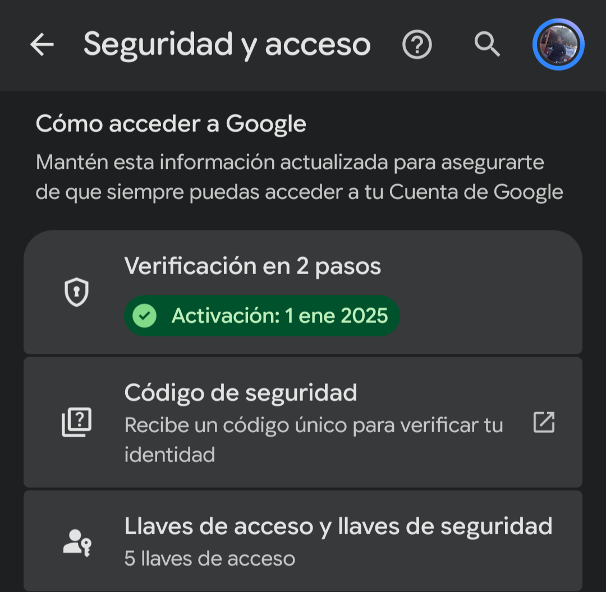
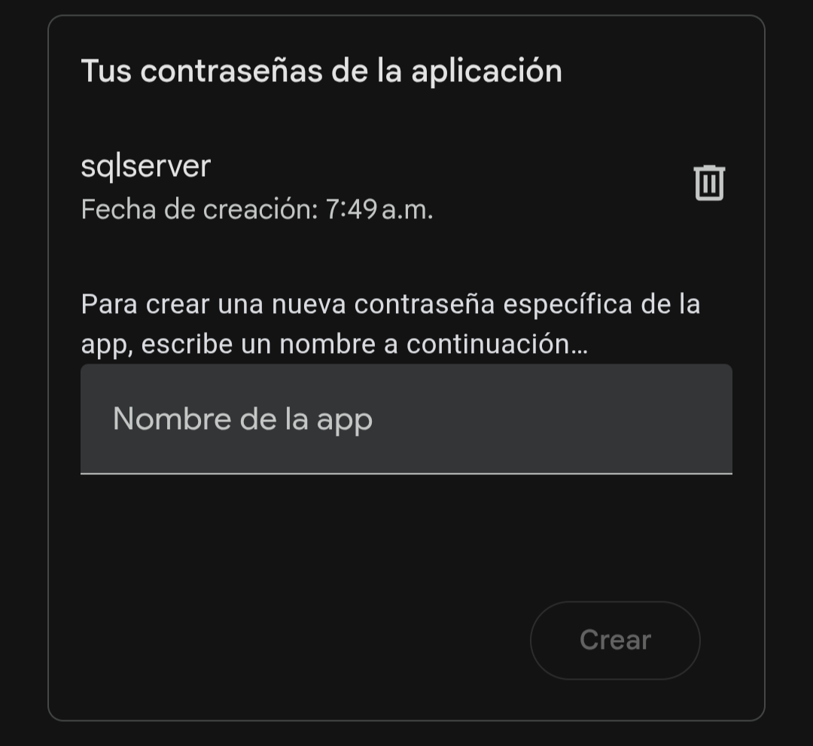
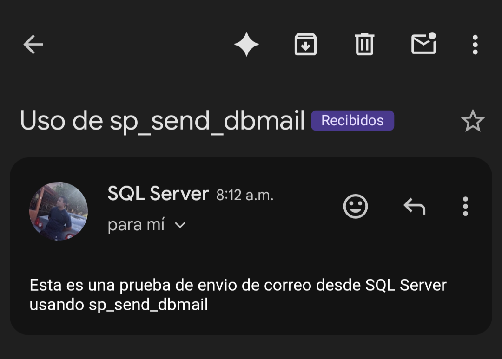

# Actividad 3. Configuración de Database Mail

**Carrera:** Tecnologías de la Información  
**Materia:** Temas Selectos de Tratamiento de Información  
**Actividad:** Actividad 3. Configuración de Database Mail  
**Alumno:** Rodríguez Macias Carlos Gabriel  
**Docente:** Gómez Arellano Athala Dulce Edith  
**Lugar:** Nuevo Laredo, Tamaulipas  
**Fecha:** 1 de septiembre de 2026

---

# Database Mail
Es una solución empresarial dentro de SQL Server enfocada en el envío de correo electrónico.

## Configuración
En esta actividad trabajaremos con un correo de Gmail. Para ello, ingresaremos a "Cuenta de Google".

Confirmamos y/o activamos la verificación en dos pasos.



<p align="center"><em>Figura 1.1. Verificación en dos pasos activada en la cuenta de Google.</em></p>

Una vez confirmada la verificación en dos pasos, continuamos con la creación de la contraseña que se usará en esta actividad.

Para ello, buscamos "Contraseñas de aplicaciones".

Una vez dentro, se escribe el nombre de la aplicación: sqlserver.



<p align="center"><em>Figura 1.2. Configuración de la contraseña de aplicación para SQL Server.</em></p>

Se crea una contraseña de aplicación. La cual es: **gaoh bmob mpyn gqpi**.

## Configuración en SQL Server
Debido a que el servidor se trabajó en Ubuntu, la configuración se realizó mediante código T-SQL y no con la interfaz visual de SSMS.

### Paso 1. Habilitar las opciones avanzadas

Se habilitaron las opciones avanzadas para poder modificar la configuración de Database Mail.

```sql
-- ? Habilitar las opciones avanzadas
Use master;
Exec sp_configure 'show advanced options', 1;
Reconfigure;
```

### Paso 2. Habilitar Database Mail

Se activó `Database Mail XPs`, que permite usar Database Mail en la instancia.

```sql
-- ? Habilitar Database Mail
Exec sp_configure 'Database Mail XPs', 1;
Reconfigure;
```

### Paso 3. Crear la cuenta de Gmail

Se creó la cuenta `cuentaGmailSQL` con el servidor SMTP de Gmail, puerto 587 y una conexión segura. La contraseña de aplicación se escribe únicamente al ejecutar el código y no se guarda en el archivo.

```sql
-- ? Crear la cuenta de Gmail
Exec msdb.dbo.sysmail_add_account_sp
  @account_name = 'cuentaGmailSQL',
  @description = 'Cuenta de Gmail para enviar correos desde SQL Server',
  @email_address = 'carlosgabrielrm1444@gmail.com',
  @display_name = 'SQL Server',
  @replyto_address = 'carlosgabrielrm1444@gmail.com',
  @mailserver_name = 'smtp.gmail.com',
  @port = 587,
  @username = 'carlosgabrielrm1444@gmail.com',
  @password = 'gaoh bmob mpyn gqpi',
  @use_default_credentials = 0,
  @enable_ssl = 1;
```

### Paso 4. Crear el perfil de Database Mail

Se creó el perfil `administradorSQL` para agrupar la cuenta de correo.

```sql
-- ? Crear el perfil para Database Mail
Exec msdb.dbo.sysmail_add_profile_sp
  @profile_name = 'administradorSQL',
  @description = 'Perfil para enviar correos desde SQL Server';
```

### Paso 5. Agregar la cuenta al perfil

Se relacionó la cuenta de Gmail con el perfil creado.

```sql
-- ? Agregar la cuenta al perfil
Exec msdb.dbo.sysmail_add_profileaccount_sp
  @profile_name = 'administradorSQL',
  @account_name = 'cuentaGmailSQL',
  @sequence_number = 1;
```

### Paso 6. Dar permiso al perfil

Se dio permiso al perfil para poder usarlo desde la práctica.

```sql
-- ? Dar permiso al perfil
Exec msdb.dbo.sysmail_add_principalprofile_sp
  @profile_name = 'administradorSQL',
  @principal_name = 'public',
  @is_default = 1;
```

### Paso 7. Enviar un correo de prueba

Se ejecutó `sp_send_dbmail` para enviar un correo de prueba.

```sql
-- ? Código para enviar un correo
Exec msdb.dbo.sp_send_dbmail
  @profile_name = 'administradorSQL',
  @recipients = 'carlosgabrielrm1444@gmail.com',
  @subject = 'Uso de sp_send_dbmail',
  @body = 'Esta es una prueba de envío de correo desde SQL Server usando sp_send_dbmail';
```

### Paso 8. Revisar el historial y los errores

Se consultaron los correos registrados por Database Mail, el historial de eventos y el estado del último correo enviado. Cuando el campo `sent_status` muestra `sent`, el envío fue correcto.

```sql
-- ? Ver todos los correos que Database Mail ha intentado enviar
Select * From msdb.dbo.sysmail_allitems;

-- ? Ver la información y los errores que se presenten al enviar correos
Select * From msdb.dbo.sysmail_event_log;

-- ? Ver el último correo enviado y confirmar que sent_status diga sent
SELECT TOP 1
  mailitem_id,
  sent_status,
  send_request_date,
  sent_date,
  recipients,
  subject
FROM msdb.dbo.sysmail_allitems
ORDER BY mailitem_id DESC;
```

En el primer intento el correo no se pudo enviar porque la red bloqueaba la conexión al puerto SMTP de Gmail. Después de cambiar de red se realizó un nuevo envío y el correo se recibió correctamente en el teléfono.

El código utilizado se encuentra en el archivo `scripts/actividad_3.sql`.

## Evidencia del correo recibido
Después de cambiar de red, el correo de prueba fue enviado correctamente desde SQL Server y recibido en Gmail.



<p align="center"><em>Figura 1.3. Correo de prueba recibido en Gmail.</em></p>


<p align="center"><em>Figura 1.4. Notificación del correo recibido en el teléfono.</em></p>

## Conclusión

Creo que este tema es importante para nuestra carrera, ya que el monitoreo de una base de datos es de suma importancia al representar una gran responsabilidad para nosotros como encargados de sistemas. Sin embargo, considero que existen mejores formas de realizar automatizaciones para el monitoreo y las notificaciones de los sistemas de bases de datos.