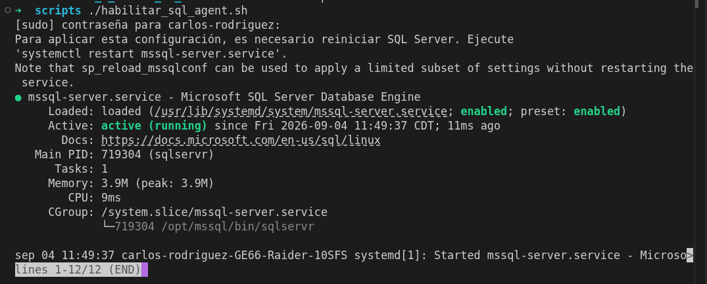
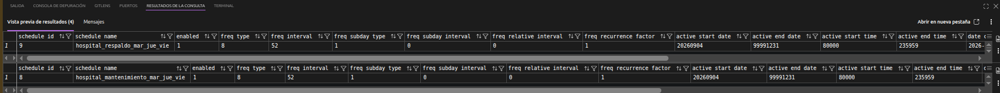
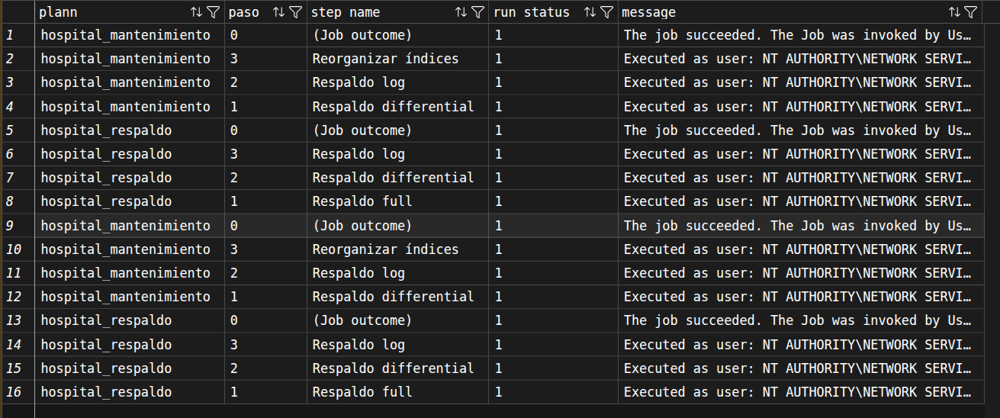
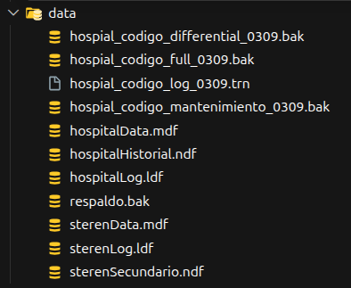

# Actividad 4. Planes de Mantenimiento

**Carrera:** Tecnologías de la Información  
**Materia:** Temas Selectos de Tratamiento de Información  
**Actividad:** Actividad 4. Planes de Mantenimiento  
**Alumno:** Rodríguez Macias Carlos Gabriel  
**Docente:** Gómez Arellano Athala Dulce Edith  
**Lugar:** Nuevo Laredo, Tamaulipas  
**Fecha:** 3 de septiembre de 2026

---

# Respaldos

En esta actividad se trabajó con la base de datos `hospital_sql` para realizar los respaldos full, differential y log.

La ruta indicada es `C:\Data`, pero esa ruta corresponde a Windows. Debido a que el disco duro está instalado y montado en Linux, se utiliza la ruta `/media/carlos-rodriguez/nvme0n1p1/2db/data`.

Primero se utiliza el modelo de recuperación `FULL`, ya que se realizará un respaldo del log de transacciones.

```sql
Use master;

Alter Database hospital_sql
Set Recovery Full;
```

## Respaldo completo (Full)

```sql
Backup Database hospital_sql
To Disk = '/media/carlos-rodriguez/nvme0n1p1/2db/data/hospial_codigo_full_0309.bak'
With Init, Format,
Name = 'Respaldo full hospital_sql',
Description = 'Respaldo full de la base hospital_sql';
```

## Respaldo differential

```sql
Backup Database hospital_sql
To Disk = '/media/carlos-rodriguez/nvme0n1p1/2db/data/hospial_codigo_differential_0309.bak'
With Differential,
Name = 'Respaldo differential hospital_sql',
Description = 'Respaldo differential de la base hospital_sql';
```

## Respaldo de registro de transacciones (Log)

```sql
Backup Log hospital_sql
To Disk = '/media/carlos-rodriguez/nvme0n1p1/2db/data/hospial_codigo_log_0309.trn'
With Init, Format,
Name = 'Respaldo log hospital_sql',
Description = 'Respaldo log de la base hospital_sql';
```

# Planes de mantenimiento

El asistente para planes de mantenimiento permite crear un plan de mantenimiento que el Agent SQL Server puede ejecutar periódicamente, realizando diversas tareas de administración de base de datos.

Debido a que el servidor se trabajó en Ubuntu y no se cuenta con SSMS, los pasos que se realizan desde Administración y Planes de mantenimiento se adaptaron a código T-SQL.

## Configuración

### Paso 1. Habilitar el Agent SQL Server

Primero se habilita SQL Server Agent. Este es el servicio que ejecutará los trabajos programados.

```bash
#!/bin/bash

# ? Habilitar SQL Server Agent en Ubuntu
sudo /opt/mssql/bin/mssql-conf set sqlagent.enabled true
sudo systemctl restart mssql-server
sudo systemctl status mssql-server
```

### Paso 2. Habilitar las opciones del Agent

Una vez habilitado el Agent, se habilitan las opciones necesarias desde T-SQL para poder trabajar con los trabajos programados.

```sql
Exec sp_configure 'show advanced options', 1;
Reconfigure;

Exec sp_configure 'Agent XPs', 1;
Reconfigure;
```

### Paso 3. Crear el plan hospital_respaldo

En SSMS se ingresaría a Administración, se desplegaría Planes de mantenimiento y se utilizaría el asistente. Como se trabaja con código, se crea el trabajo `hospital_respaldo` en la base `msdb`.

```sql
Use msdb;

Exec sp_add_job
  @job_name = 'hospital_respaldo',
  @description = 'Respaldos full, differential y log de la base hospital_sql.';
```

### Paso 4. Seleccionar y ordenar las acciones

El plan anterior contiene las acciones de respaldo full, differential y log. El orden se deja de la misma forma: full, differential y log.

```sql
Exec sp_add_jobstep
  @job_name = 'hospital_respaldo',
  @step_name = 'Respaldo full',
  @subsystem = 'TSQL',
  @command = N'
Backup Database hospital_sql
To Disk = ''/media/carlos-rodriguez/nvme0n1p1/2db/data/hospial_codigo_full_0309.bak''
With Init, Format,
Name = ''Respaldo full'',
Description = ''Respaldo completo de hospital_sql'';',
  @database_name = 'master',
  @on_success_action = 3;

Exec sp_add_jobstep
  @job_name = 'hospital_respaldo',
  @step_name = 'Respaldo differential',
  @subsystem = 'TSQL',
  @command = N'
Backup Database hospital_sql
To Disk = ''/media/carlos-rodriguez/nvme0n1p1/2db/data/hospial_codigo_differential_0309.bak''
With Differential, Init, Format,
Name = ''Respaldo differential'',
Description = ''Respaldo differential de hospital_sql'';',
  @database_name = 'master',
  @on_success_action = 3;

Exec sp_add_jobstep
  @job_name = 'hospital_respaldo',
  @step_name = 'Respaldo log',
  @subsystem = 'TSQL',
  @command = N'
Backup Log hospital_sql
To Disk = ''/media/carlos-rodriguez/nvme0n1p1/2db/data/hospial_codigo_log_0309.trn''
With Init, Format,
Name = ''Respaldo log'',
Description = ''Respaldo del log de hospital_sql'';',
  @database_name = 'master';
```

### Paso 5. Programar el plan

Se utiliza una sola programación para todo el plan. El trabajo se ejecutará los martes, jueves y viernes a las 08:00.

```sql
Exec sp_add_jobschedule
  @job_name = 'hospital_respaldo',
  @name = 'hospital_respaldo_mar_jue_vie',
  @freq_type = 8,
  @freq_interval = 52,
  @freq_recurrence_factor = 1,
  @active_start_time = 080000;

Exec sp_add_jobserver
  @job_name = 'hospital_respaldo';
```

### Paso 6. Iniciar y ejecutar el plan

Después de habilitar el Agent, se inicia y ejecuta el plan mediante el nombre del trabajo. Después de que termine se puede consultar el historial.

```sql
Exec sp_start_job @job_name = 'hospital_respaldo';

Select * From sysjobhistory;
```

# Plan de mantenimiento en un mismo archivo de respaldo

Ahora se crea un segundo plan llamado `hospital_mantenimiento`. Este plan realizará el respaldo differential, el respaldo log y la reorganización de índices.

El respaldo differential y el respaldo log se guardan en el mismo archivo. Primero se crea el archivo con el respaldo differential y después se utiliza `NOINIT` para agregar el respaldo log sin borrar el contenido anterior.

### Paso 7. Crear el plan y guardar differential y log en el mismo archivo

```sql
Exec sp_add_job
  @job_name = 'hospital_mantenimiento',
  @description = 'Respaldo differential, log y reorganización de índices de hospital_sql.';

Exec sp_add_jobstep
  @job_name = 'hospital_mantenimiento',
  @step_name = 'Respaldo differential',
  @subsystem = 'TSQL',
  @command = N'
Backup Database hospital_sql
To Disk = ''/media/carlos-rodriguez/nvme0n1p1/2db/data/hospial_codigo_mantenimiento_0309.bak''
With Differential, Init, Format,
Name = ''Respaldo differential de mantenimiento'',
Description = ''Respaldo differential de hospital_sql'';',
  @database_name = 'master',
  @on_success_action = 3;

Exec sp_add_jobstep
  @job_name = 'hospital_mantenimiento',
  @step_name = 'Respaldo log',
  @subsystem = 'TSQL',
  @command = N'
Backup Log hospital_sql
To Disk = ''/media/carlos-rodriguez/nvme0n1p1/2db/data/hospial_codigo_mantenimiento_0309.bak''
With NoInit,
Name = ''Respaldo log de mantenimiento'',
Description = ''Respaldo log de hospital_sql en el mismo archivo'';',
  @database_name = 'master',
  @on_success_action = 3;
```

### Paso 8. Reorganizar índices

Después de los respaldos se reorganizan los índices de las tablas de la base hospital. Esto ayuda a ordenar los datos que se encuentran en los índices.

```sql
Exec sp_add_jobstep
  @job_name = 'hospital_mantenimiento',
  @step_name = 'Reorganizar índices',
  @subsystem = 'TSQL',
  @command = N'
Alter Index All On dbo.doctores Reorganize;
Alter Index All On dbo.especialidades Reorganize;
Alter Index All On dbo.rel_doctores_especialidades Reorganize;',
  @database_name = 'hospital_sql';
```

### Paso 9. Programar el nuevo plan

Una vez terminada la selección de las acciones y las rutas, se procede a crear la programación. El nuevo plan se ejecutará los martes, jueves y viernes a las 08:00.

```sql
Exec sp_add_jobschedule
  @job_name = 'hospital_mantenimiento',
  @name = 'hospital_mantenimiento_mar_jue_vie',
  @freq_type = 8,
  @freq_interval = 52,
  @freq_recurrence_factor = 1,
  @active_start_time = 080000;

Exec sp_add_jobserver
  @job_name = 'hospital_mantenimiento';
```

## Evidencias



<p align="center"><em>Figura 1.1. Servicio SQL Server activo después de habilitar la configuración del Agent.</em></p>



<p align="center"><em>Figura 1.2. Horarios configurados para los planes de mantenimiento.</em></p>



<p align="center"><em>Figura 1.3. Historial de ejecución exitosa de los planes de mantenimiento.</em></p>



<p align="center"><em>Figura 1.4. Archivos de respaldo creados en la carpeta data.</em></p>

## Conclusión

Yo creo que los planes de mantenimiento son importantes porque evitan realizar estos trabajos de contingencia de forma manual y te permiten automatizarlo, Y estas tareas ayudan a recuperar la informacion en caso de que alguna incidencia suceda.
