# Actividad 5. Auditorías

**Carrera:** Tecnologías de la Información  
**Materia:** Temas Selectos de Tratamiento de Información  
**Actividad:** Actividad 5. Auditorías  
**Alumno:** Rodríguez Macias Carlos Gabriel  
**Docente:** Gómez Arellano Athala Dulce Edith  
**Lugar:** Nuevo Laredo, Tamaulipas  
**Fecha:** 8 de septiembre de 2026

---

# Auditorías

Auditar significa examinar procesos, cuentas y actividades. En el caso de una base de datos, la auditoría es un proceso importante para mantener la integridad y seguridad de los datos, además de ayudar a cumplir requisitos de seguridad como los de la norma ISO 27001.

En SQL Server existen diferentes formas de auditar:

- SQL Server Profiler, el cual actualmente se encuentra en desuso.
- Seguimiento de auditoría C2, el cual genera muchos archivos y puede ocupar bastante espacio.
- Auditoría en el servidor y en la base de datos.
- Eventos extendidos.

Debido a que se está trabajando con SQL Server en Ubuntu y no se cuenta con SSMS, las opciones que normalmente se realizan desde una interfaz gráfica se adaptaron a código T-SQL y comandos de Linux.

# Preparación

### Paso 1. Crear el directorio de las auditorías

En Windows se utiliza la ruta `C:\Data`. En este caso se utiliza `/var/opt/mssql/audit/actividad_5`, porque SQL Server está instalado en Ubuntu y el servicio se ejecuta con el usuario `mssql`.

Primero se crea el directorio y se le dan permisos al usuario de SQL Server.

```bash
#!/bin/bash

# ? Crear la carpeta donde SQL Server guardará las auditorías y eventos.
sudo mkdir -p /var/opt/mssql/audit/actividad_5

# ? Dar permisos al usuario de SQL Server.
sudo chown mssql:mssql /var/opt/mssql/audit/actividad_5
sudo chmod 770 /var/opt/mssql/audit/actividad_5

# ? Verificar la carpeta.
sudo ls -ld /var/opt/mssql/audit/actividad_5
```

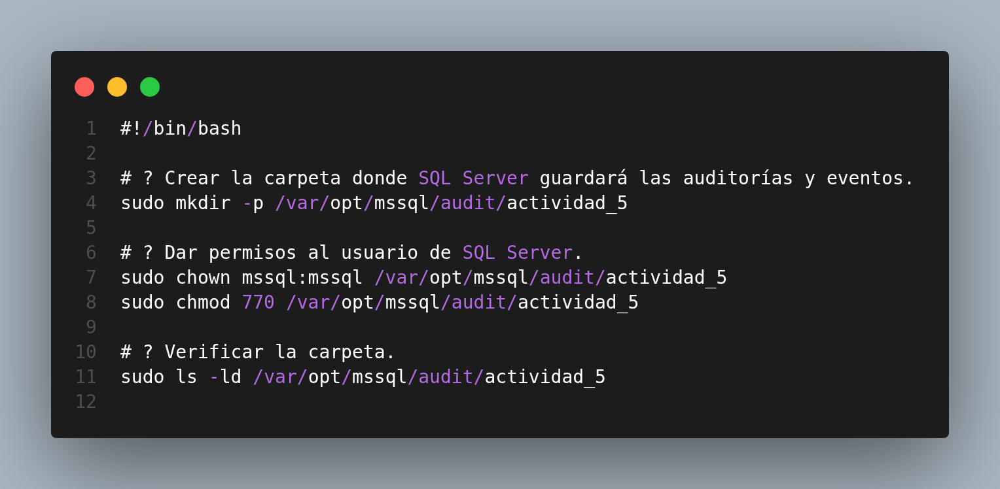

<p align="center"><em>Figura 1.1. Código utilizado para crear el directorio de las auditorías y asignar los permisos.</em></p>

### Paso 2. Revisar SQL Server y las bases de datos

Antes de comenzar se consulta la versión, edición y las bases de datos disponibles. Esto permite comprobar que el servidor está funcionando y que se encuentra la base `hospital_sql`.

```sql
Use master;

Select
  @@VERSION As version_sql_server,
  ServerProperty('Edition') As edicion;

Select name, state_desc
From sys.databases
Order By name;
```

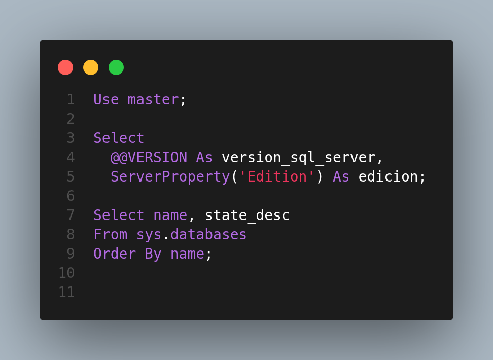

<p align="center"><em>Figura 1.2. Código utilizado para consultar la versión instalada de SQL Server.</em></p>

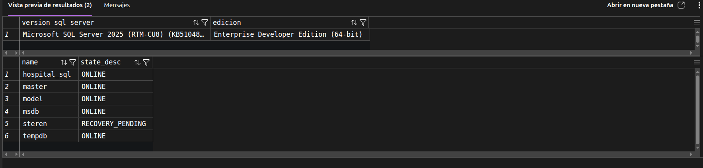

<p align="center"><em>Figura 1.3. Versión y edición de SQL Server junto con las bases de datos disponibles.</em></p>

# SQL Server Profiler

SQL Server Profiler permite capturar y analizar eventos que ocurren en el servidor. En windows se crea una traza y se guarda en un archivo `.trc`, pero Profiler no se encuentra disponible en Ubuntu.

Para realizar la misma actividad por medio de código se utilizaron eventos extendidos. La información se guarda en un archivo `.xel`, el cual cumple la función de registrar las consultas ejecutadas.

### Paso 3. Crear la sesión de eventos extendidos

Se crea una sesión que captura los lotes de instrucciones T-SQL y los procedimientos ejecutados. También se guarda el nombre de la base de datos, el usuario, el equipo cliente y la instrucción ejecutada.

```sql
Use master;

Create Event Session actividad_5_profiler
On Server
Add Event sqlserver.sql_batch_completed
(
  Action
  (
    sqlserver.client_app_name,
    sqlserver.client_hostname,
    sqlserver.database_name,
    sqlserver.server_principal_name,
    sqlserver.sql_text
  )
),
Add Event sqlserver.rpc_completed
(
  Action
  (
    sqlserver.client_app_name,
    sqlserver.client_hostname,
    sqlserver.database_name,
    sqlserver.server_principal_name,
    sqlserver.sql_text
  )
)
Add Target package0.event_file
(
  Set Filename = N'/var/opt/mssql/audit/actividad_5/actividad_5_profiler.xel',
      Max_File_Size = (10),
      Max_Rollover_Files = (2)
);
```

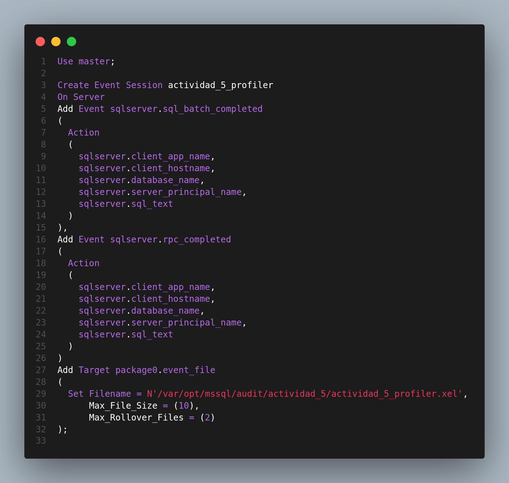

<p align="center"><em>Figura 1.4. Código utilizado para crear la sesión de eventos extendidos.</em></p>

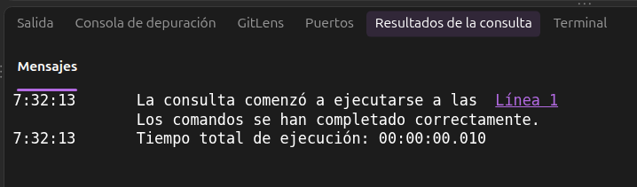

<p align="center"><em>Figura 1.5. Mensaje de ejecución correcta al crear la sesión de eventos extendidos.</em></p>

### Paso 4. Iniciar la sesión y generar un evento

Primero se comprueba que la sesión fue creada, después se inicia y se ejecuta una consulta sencilla en `hospital_sql` para generar información.

```sql
Select name, event_retention_mode_desc, startup_state
From sys.server_event_sessions
Where name = 'actividad_5_profiler';

Alter Event Session actividad_5_profiler
On Server
State = Start;

Use hospital_sql;

Select name
From sys.tables;
```

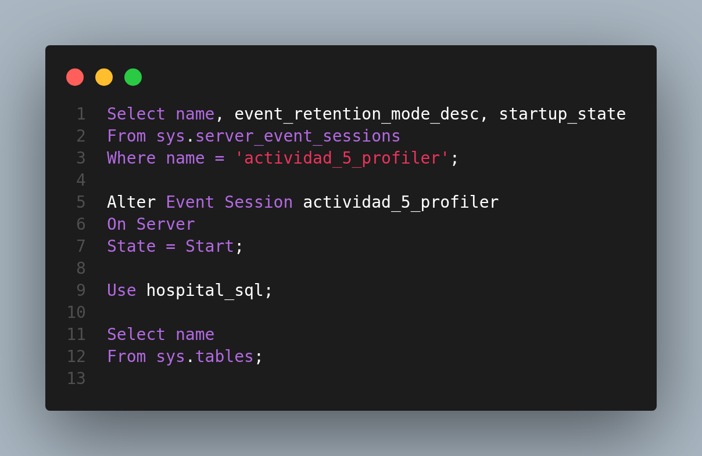

<p align="center"><em>Figura 1.6. Código utilizado para iniciar la sesión y consultar las tablas de hospital_sql.</em></p>

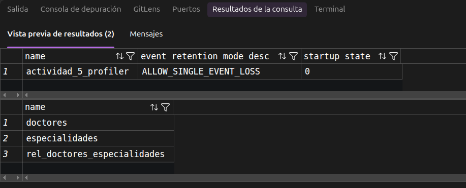

<p align="center"><em>Figura 1.7. Sesión actividad_5_profiler creada y tablas consultadas en hospital_sql.</em></p>

### Paso 5. Detener y consultar la sesión

Después de generar el evento se detiene la sesión y se consulta el contenido de los archivos `.xel`.

```sql
Use master;

Alter Event Session actividad_5_profiler
On Server
State = Stop;

With eventos As
(
  Select Cast(event_data As xml) As evento
  From sys.fn_xe_file_target_read_file
  (
    '/var/opt/mssql/audit/actividad_5/actividad_5_profiler*.xel',
    Null,
    Null,
    Null
  )
)
Select
  evento.value('(event/@timestamp)[1]', 'datetime2') As fecha,
  evento.value('(event/@name)[1]', 'varchar(100)') As evento,
  evento.value('(event/action[@name="database_name"]/value)[1]', 'varchar(100)') As base_datos,
  evento.value('(event/action[@name="server_principal_name"]/value)[1]', 'varchar(100)') As usuario,
  evento.value('(event/action[@name="sql_text"]/value)[1]', 'varchar(max)') As instruccion
From eventos
Order By fecha Desc;
```

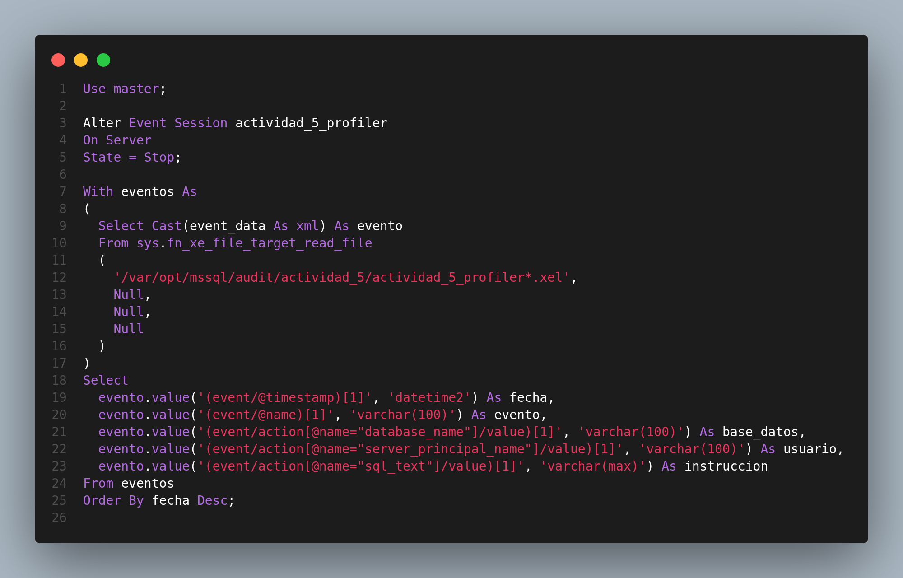

<p align="center"><em>Figura 1.8. Código utilizado para detener la sesión y leer los eventos almacenados en el archivo XEL.</em></p>

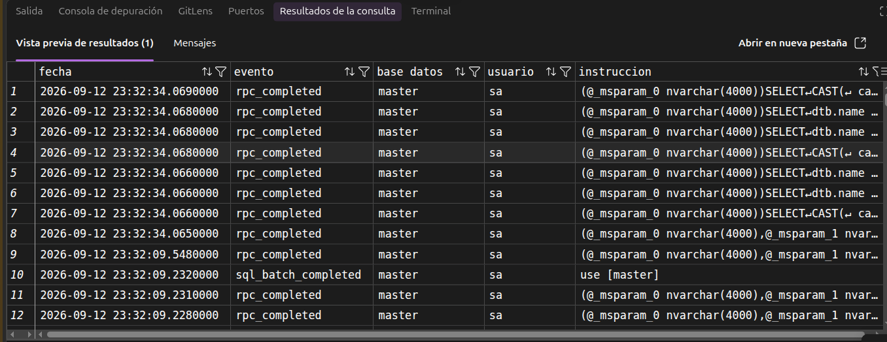

<p align="center"><em>Figura 1.9. Eventos registrados por la sesión y consultados desde el archivo XEL.</em></p>

# Configurar C2

El seguimiento de auditoría C2 registra los intentos de acceso a instrucciones y objetos. Esta opción genera bastante información, por lo que se habilita solamente para realizar la actividad y después se deshabilita.

En SSMS se entraría a las propiedades del servidor y se activaría la opción de auditoría C2. En Ubuntu se realiza directamente con `sp_configure`.

### Paso 6. Consultar y habilitar C2

Primero se consulta el estado actual de la opción y después se habilita.

```sql
Use master;

Select name, value, value_in_use, is_dynamic
From sys.configurations
Where name = 'c2 audit mode';

Exec sp_configure 'show advanced options', 1;
Reconfigure;

Exec sp_configure 'c2 audit mode', 1;
Reconfigure;
```

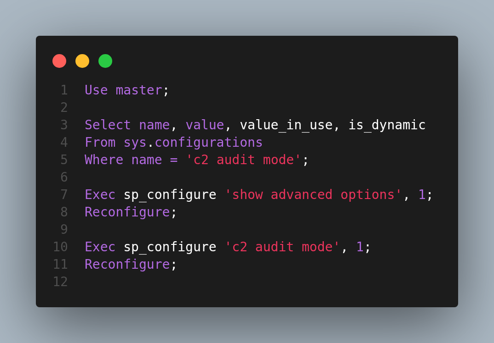

<p align="center"><em>Figura 1.10. Código utilizado para consultar el estado y habilitar el seguimiento de auditoría C2.</em></p>

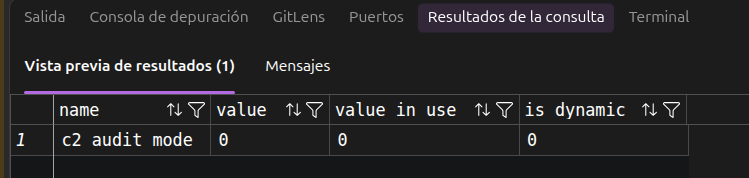

<p align="center"><em>Figura 1.11. Estado inicial del seguimiento C2 antes de reiniciar SQL Server.</em></p>

### Paso 7. Reiniciar SQL Server

Después de habilitar C2 es necesario reiniciar SQL Server. El reinicio se realiza desde la terminal de Ubuntu.

```bash
#!/bin/bash

# ! Ejecutar solamente después de habilitar C2.
sudo systemctl restart mssql-server

# ? Verificar que SQL Server volvió a iniciar.
sudo systemctl status mssql-server --no-pager
```

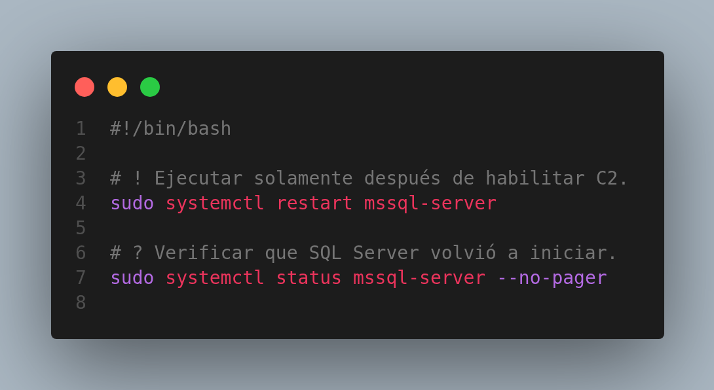

<p align="center"><em>Figura 1.12. Comandos utilizados para reiniciar SQL Server y consultar su estado.</em></p>

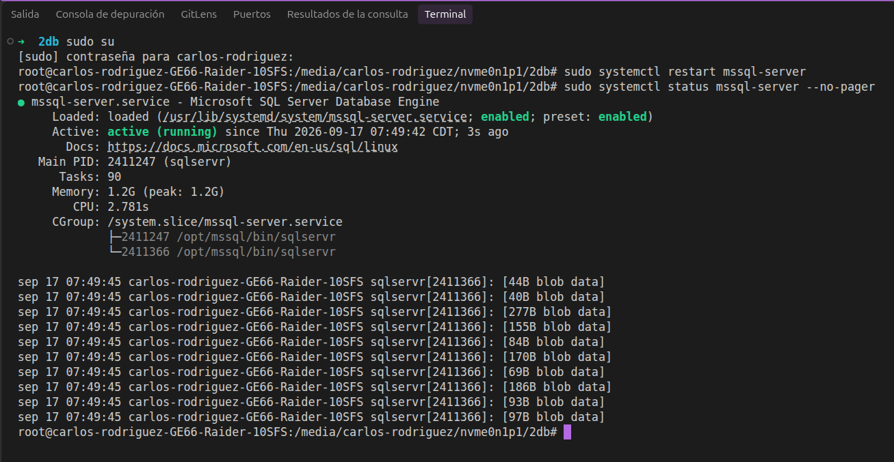

<p align="center"><em>Figura 1.13. Servicio mssql-server activo después de aplicar la configuración de C2.</em></p>

Después del reinicio se comprueba que C2 está activo y se consulta la traza creada por el servidor.

```sql
Use master;

Select name, value, value_in_use, is_dynamic
From sys.configurations
Where name = 'c2 audit mode';

Select id, status, path, start_time
From sys.traces
Where is_default = 0;
```

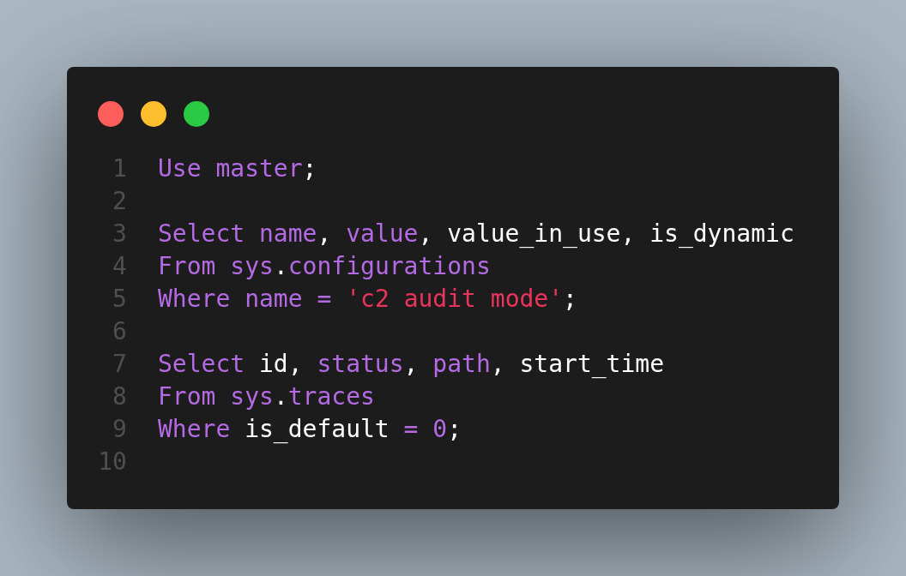

<p align="center"><em>Figura 1.14. Código utilizado para comprobar el seguimiento C2 después del reinicio.</em></p>

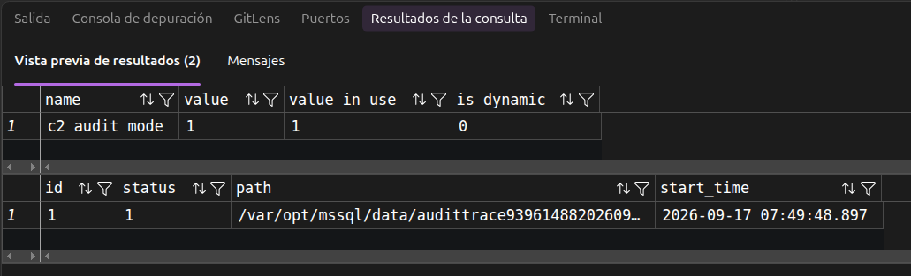

<p align="center"><em>Figura 1.15. Seguimiento C2 habilitado y traza almacenada en el directorio de datos de SQL Server.</em></p>

# Auditoría en el servidor

Una auditoría de servidor permite registrar acciones que afectan a todo SQL Server. En esta parte se crea la auditoría, se indica dónde se guardarán los archivos y después se agregan los grupos solicitados por la profesora.

### Paso 8. Crear y habilitar la auditoría

La auditoría se guardará en la misma carpeta que se preparó al inicio. Cada archivo tendrá un tamaño máximo de 10 MB y se conservarán hasta cinco archivos.

```sql
Use master;

Create Server Audit auditoria_actividad_5
To File
(
  Filepath = '/var/opt/mssql/audit/actividad_5/',
  Maxsize = 10 MB,
  Max_Rollover_Files = 5,
  Reserve_Disk_Space = Off
)
With
(
  Queue_Delay = 1000,
  On_Failure = Continue
);

Alter Server Audit auditoria_actividad_5
With (State = On);
```

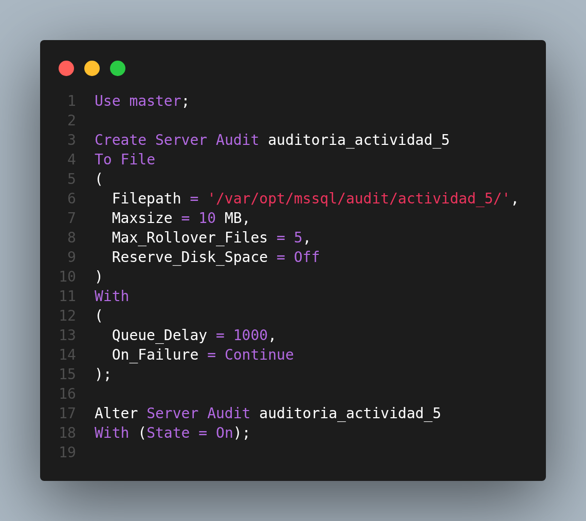

<p align="center"><em>Figura 1.16. Código utilizado para crear y habilitar la auditoría del servidor.</em></p>

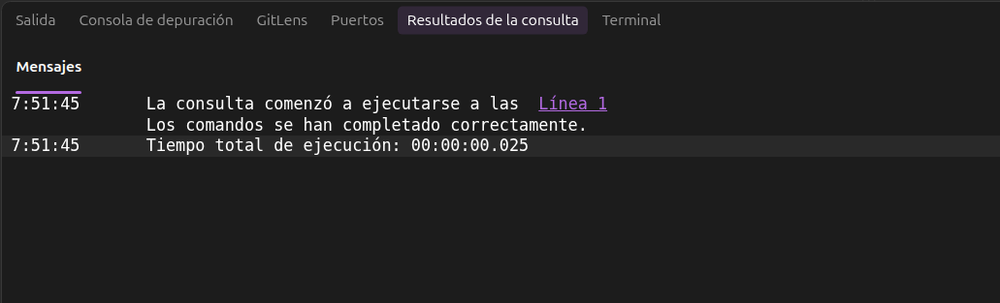

<p align="center"><em>Figura 1.17. Mensaje de ejecución correcta al crear y habilitar la auditoría.</em></p>

### Paso 9. Crear la especificación de auditoría del servidor

La especificación contiene las acciones solicitadas: confirmación de transacciones, cambio de contraseña de usuarios, respaldos o restauraciones e intentos de inicio de sesión fallidos.

```sql
Create Server Audit Specification especificacion_servidor_actividad_5
For Server Audit auditoria_actividad_5
  Add (Transaction_Commit_Group),
  Add (User_Change_Password_Group),
  Add (Backup_Restore_Group),
  Add (Failed_Login_Group)
With (State = Off);

Alter Server Audit Specification especificacion_servidor_actividad_5
With (State = On);
```

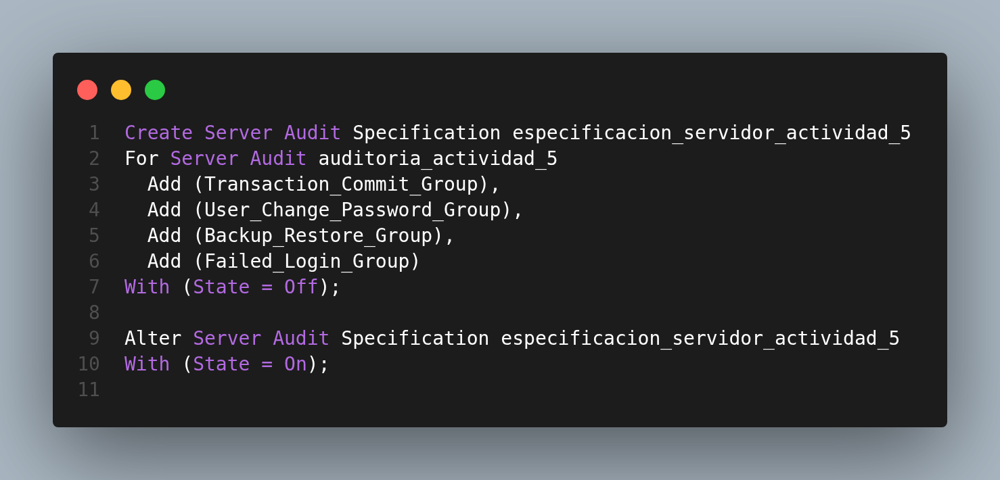

<p align="center"><em>Figura 1.18. Código utilizado para crear la especificación de auditoría del servidor.</em></p>

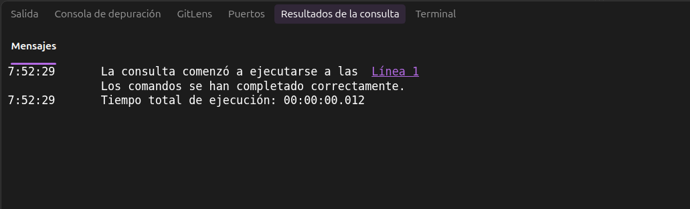

<p align="center"><em>Figura 1.19. Mensaje de ejecución correcta al crear y habilitar la especificación.</em></p>

### Paso 10. Comprobar la configuración

Se consulta la auditoría para comprobar que se encuentra activa. También se muestran las acciones que forman parte de su especificación.

```sql
Select
  name,
  type_desc,
  on_failure_desc,
  is_state_enabled
From sys.server_audits
Where name = 'auditoria_actividad_5';

Select
  especificacion.name,
  detalle.audit_action_name,
  detalle.audited_result
From sys.server_audit_specifications especificacion
Inner Join sys.server_audit_specification_details detalle
  On especificacion.server_specification_id = detalle.server_specification_id
Where especificacion.name = 'especificacion_servidor_actividad_5';
```

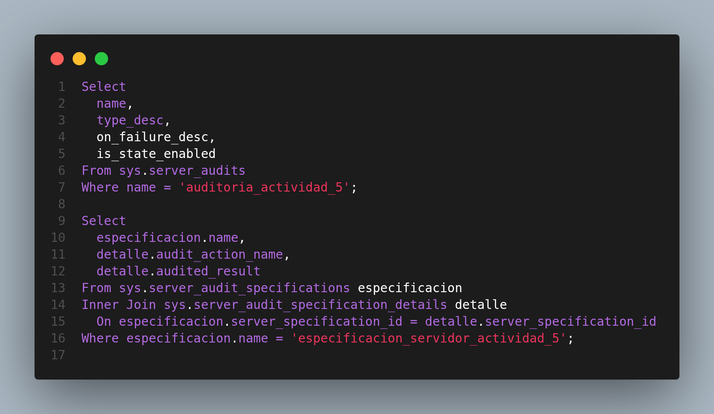

<p align="center"><em>Figura 1.20. Código utilizado para comprobar la auditoría y las acciones configuradas.</em></p>

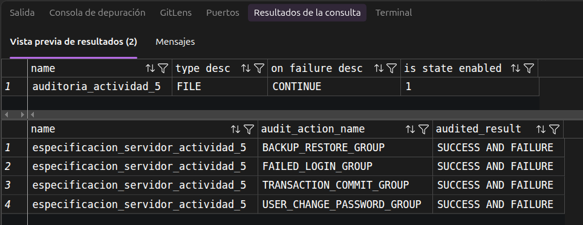

<p align="center"><em>Figura 1.21. Auditoría habilitada y grupos de acciones agregados a la especificación del servidor.</em></p>

### Paso 11. Generar eventos para la auditoría

Para comprobar la auditoría se realiza una transacción y un respaldo de `hospital_sql`.

El respaldo se guarda en `/media/carlos-rodriguez/nvme0n1p1/2db/data`, ya que el disco duro del proyecto está instalado y montado en Linux, por lo que no se puede utilizar la ruta `C:\Data` indicada para Windows.

```sql
Use hospital_sql;

Begin Transaction;
Select name From sys.tables;
Commit Transaction;

Backup Database hospital_sql
To Disk = '/media/carlos-rodriguez/nvme0n1p1/2db/data/hospital_auditoria_actividad_5.bak'
With Init, Format,
Name = 'Respaldo para auditoria',
Description = 'Prueba de la actividad 5';
```

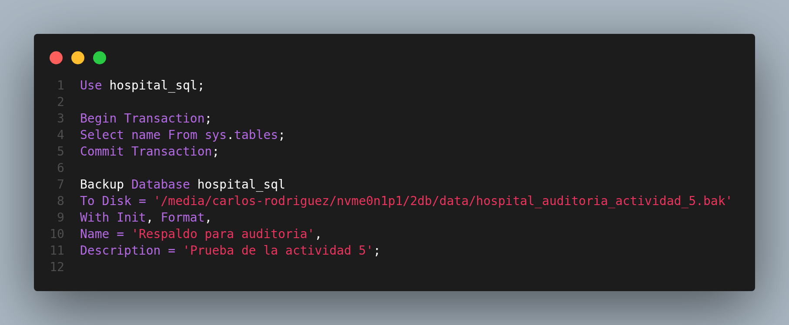

<p align="center"><em>Figura 1.22. Código utilizado para generar una transacción y un respaldo de hospital_sql.</em></p>

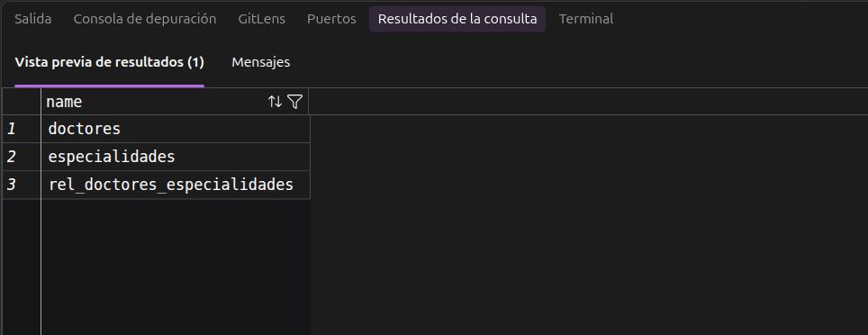

<p align="center"><em>Figura 1.23. Resultado de la consulta ejecutada dentro de la transacción de prueba.</em></p>

Para generar un inicio de sesión fallido se intenta conectar con un usuario que no existe. La contraseña incluida es solamente de prueba y no corresponde a ningún usuario real.

```bash
#!/bin/bash

# ? Generar un inicio de sesión fallido para la auditoría.
/opt/mssql-tools18/bin/sqlcmd \
  -S localhost \
  -U usuario_inexistente_auditoria \
  -P 'ClaveIncorrecta123.' \
  -C \
  -Q "Select 1;"
```

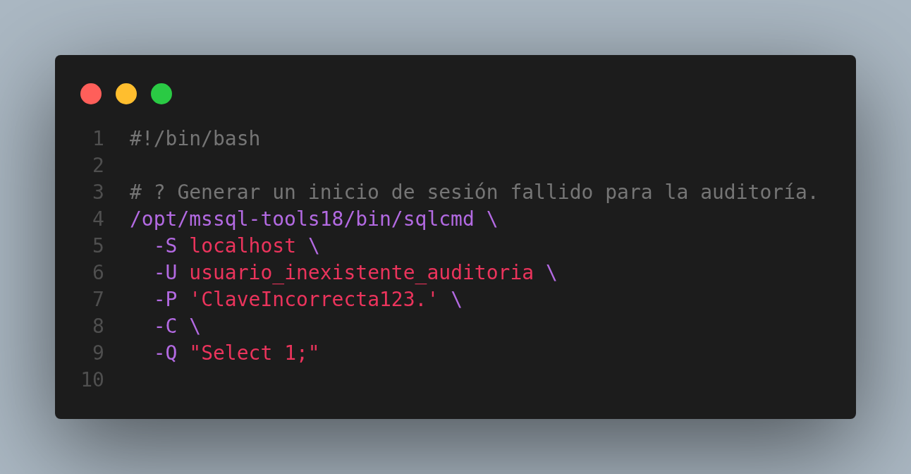

<p align="center"><em>Figura 1.24. Código utilizado para generar un intento de inicio de sesión fallido.</em></p>

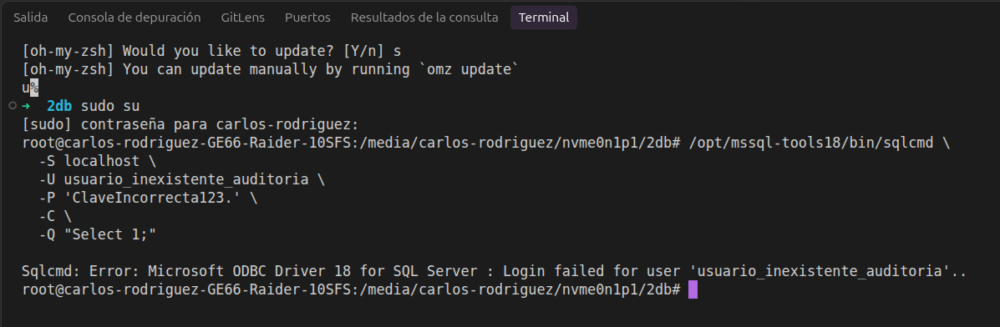

<p align="center"><em>Figura 1.25. Inicio de sesión rechazado para el usuario inexistente utilizado en la prueba.</em></p>

### Paso 12. Consultar los registros

La función `sys.fn_get_audit_file` permite leer los archivos `.sqlaudit` generados por SQL Server.

```sql
Use master;

Waitfor Delay '00:00:02';

Select
  event_time,
  action_id,
  succeeded,
  session_server_principal_name,
  database_name,
  object_name,
  statement
From sys.fn_get_audit_file
(
  '/var/opt/mssql/audit/actividad_5/*.sqlaudit',
  Default,
  Default
)
Order By event_time Desc;
```

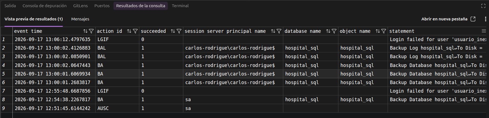

<p align="center"><em>Figura 1.26. Registros de respaldo e inicio de sesión fallido almacenados por la auditoría del servidor.</em></p>

# Auditoría en una base de datos

También es posible crear una especificación para auditar solamente ciertas acciones dentro de una base de datos. En esta actividad se registrarán las operaciones `INSERT`, `UPDATE` y `DELETE` realizadas sobre una tabla de prueba en `hospital_sql`.

### Paso 13. Crear la tabla de prueba

```sql
Use hospital_sql;

Create Table dbo.tbl_auditoria_prueba
(
  id_registro int Primary Key Identity(1, 1),
  descripcion varchar(100) Not Null,
  fecha datetime Not Null Default Getdate()
);
```

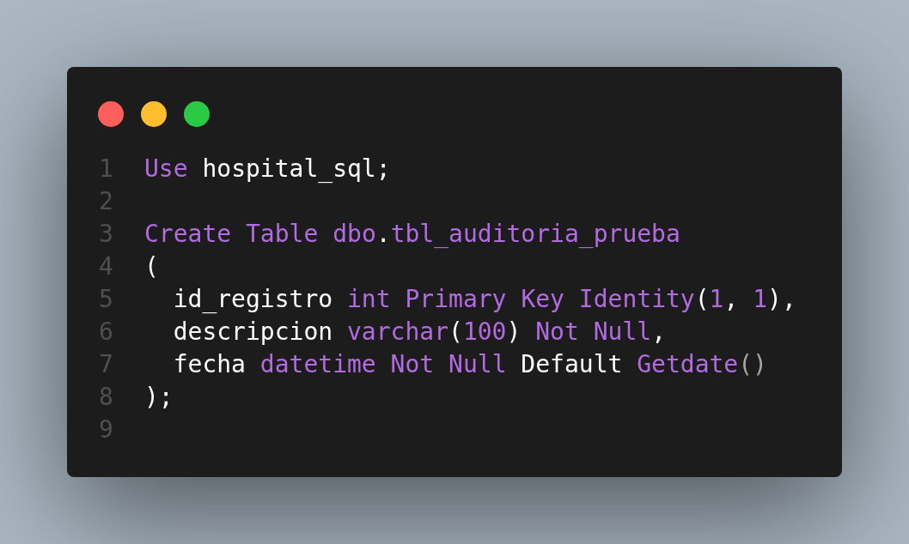

<p align="center"><em>Figura 1.27. Código utilizado para crear la tabla tbl_auditoria_prueba.</em></p>


<p align="center"><em>Figura 1.28. Mensaje de ejecución correcta al crear la tabla de prueba.</em></p>

### Paso 14. Crear la especificación de la base de datos

Los permisos se configuran para `public`, de manera que se registren las operaciones realizadas por cualquier usuario de la base de datos sobre la tabla seleccionada.

```sql
Create Database Audit Specification especificacion_bd_actividad_5
For Server Audit auditoria_actividad_5
  Add (Insert On Object::dbo.tbl_auditoria_prueba By public),
  Add (Update On Object::dbo.tbl_auditoria_prueba By public),
  Add (Delete On Object::dbo.tbl_auditoria_prueba By public)
With (State = Off);

Alter Database Audit Specification especificacion_bd_actividad_5
With (State = On);
```

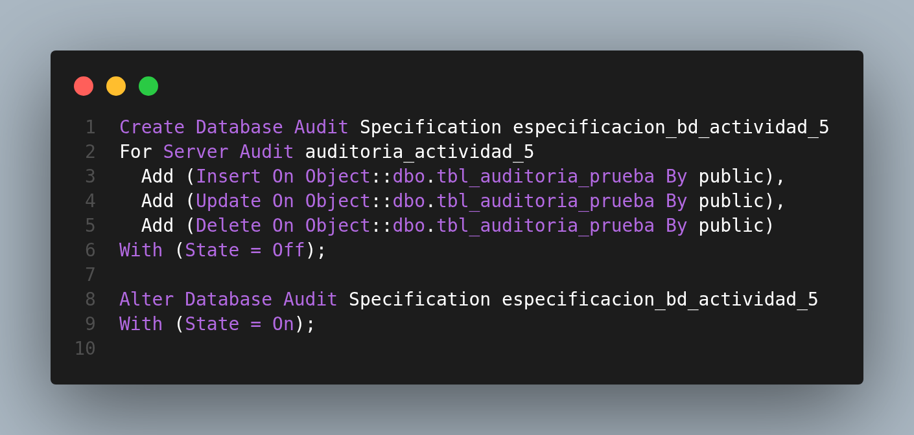

<p align="center"><em>Figura 1.29. Código utilizado para auditar las operaciones INSERT, UPDATE y DELETE.</em></p>

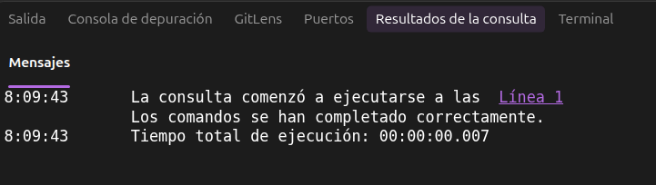

<p align="center"><em>Figura 1.30. Mensaje de ejecución correcta al crear y habilitar la especificación de la base de datos.</em></p>

### Paso 15. Comprobar las acciones configuradas

```sql
Select
  especificacion.name,
  detalle.audit_action_name,
  Object_Name(detalle.major_id) As objeto,
  User_Name(detalle.audited_principal_id) As usuario
From sys.database_audit_specifications especificacion
Inner Join sys.database_audit_specification_details detalle
  On especificacion.database_specification_id = detalle.database_specification_id
Where especificacion.name = 'especificacion_bd_actividad_5';
```

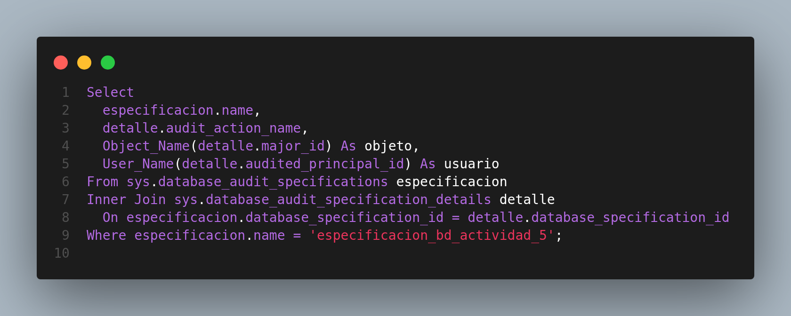

<p align="center"><em>Figura 1.31. Código utilizado para comprobar las acciones configuradas en la auditoría de la base de datos.</em></p>

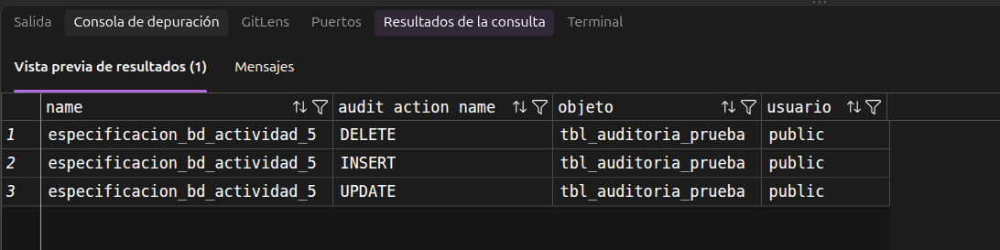

<p align="center"><em>Figura 1.32. Acciones INSERT, UPDATE y DELETE configuradas para la tabla tbl_auditoria_prueba.</em></p>

### Paso 16. Ejecutar las operaciones auditadas

Se inserta un registro, después se actualiza y al final se elimina. Estas tres acciones deben quedar almacenadas en la auditoría.

```sql
Insert Into dbo.tbl_auditoria_prueba (descripcion)
Values ('Registro de prueba');

Update dbo.tbl_auditoria_prueba
Set descripcion = 'Registro actualizado'
Where id_registro = 1;

Delete From dbo.tbl_auditoria_prueba
Where id_registro = 1;
```

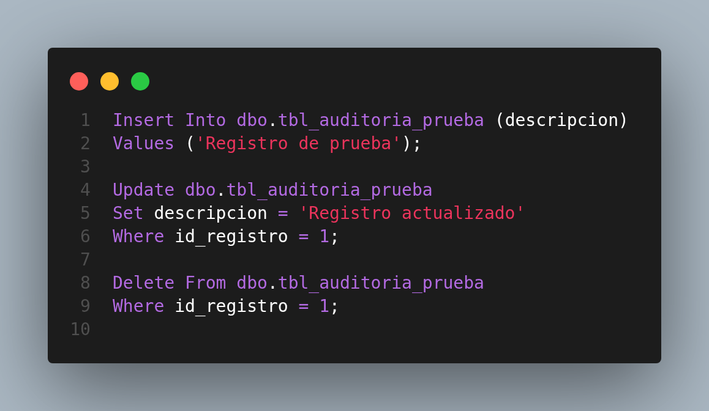

<p align="center"><em>Figura 1.33. Código utilizado para insertar, actualizar y eliminar un registro de prueba.</em></p>

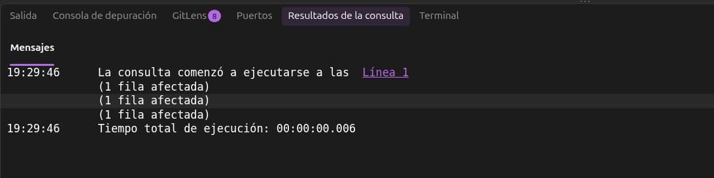

<p align="center"><em>Figura 1.34. Resultado de la ejecución de las tres operaciones auditadas.</em></p>

### Paso 17. Consultar las acciones de la tabla

La consulta se filtra por el nombre de la base de datos y de la tabla para mostrar solamente los eventos que corresponden a las pruebas anteriores.

```sql
Use master;

Waitfor Delay '00:00:02';

Select
  event_time,
  action_id,
  succeeded,
  session_server_principal_name,
  database_name,
  object_name,
  statement
From sys.fn_get_audit_file
(
  '/var/opt/mssql/audit/actividad_5/*.sqlaudit',
  Default,
  Default
)
Where database_name = 'hospital_sql'
  And object_name = 'tbl_auditoria_prueba'
Order By event_time Desc;
```

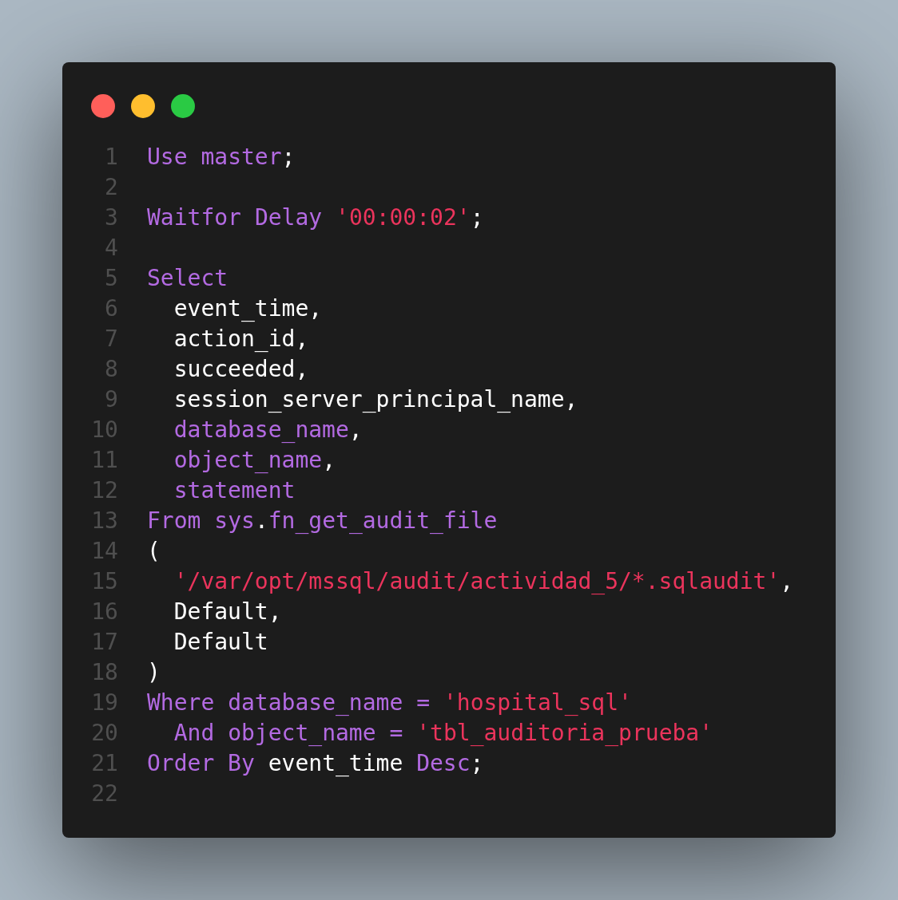

<p align="center"><em>Figura 1.35. Código utilizado para consultar las acciones registradas sobre la tabla tbl_auditoria_prueba.</em></p>

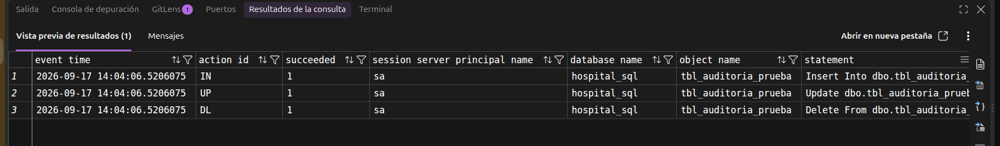

<p align="center"><em>Figura 1.36. Operaciones INSERT, UPDATE y DELETE registradas correctamente sobre la tabla tbl_auditoria_prueba.</em></p>

# Eventos extendidos

Los eventos extendidos permiten seleccionar qué actividades se desean observar y qué información se guardará de cada evento. Los archivos generados son más ligeros y se almacenan con extensión `.xel`.

En SSMS se utilizaría el asistente para crear una sesión y la opción **Watch Live Data** para observar los eventos. Como se está trabajando en Ubuntu, la sesión se crea con T-SQL y los resultados se consultan desde el archivo `.xel`.

## Sesión personalizada para hospital_sql

### Paso 18. Revisar los eventos disponibles

Primero se comprueba que los cuatro eventos seleccionados en la actividad se encuentran disponibles en la versión instalada de SQL Server.

```sql
Use master;

Select name, description
From sys.dm_xe_objects
Where object_type = 'event'
  And name In
  (
    'sql_transaction',
    'database_stopped',
    'alter_table_update_data',
    'object_deleted'
  )
Order By name;
```

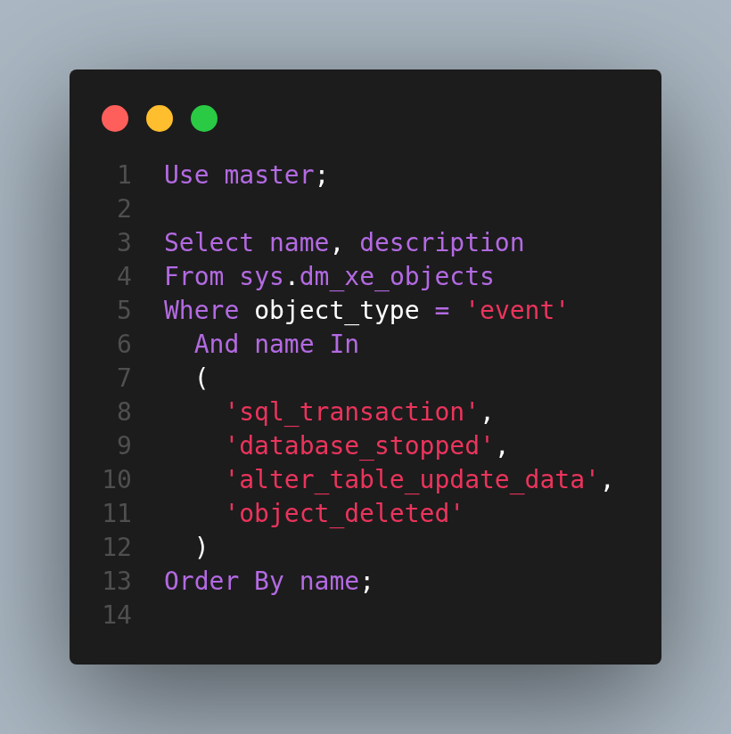

<p align="center"><em>Figura 1.37. Código utilizado para revisar los eventos disponibles en SQL Server.</em></p>

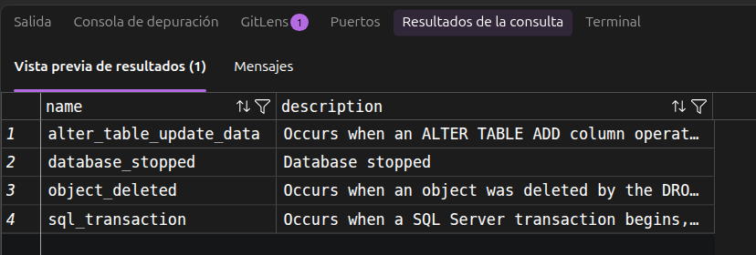

<p align="center"><em>Figura 1.38. Eventos necesarios para la sesión personalizada disponibles en SQL Server.</em></p>

### Paso 19. Crear la sesión auditar_hospital_sql

La sesión personalizada registra transacciones, detenciones de la base de datos, modificaciones realizadas con `ALTER TABLE` y objetos eliminados. También se guardan el nombre de la base, la sesión, el usuario y el código ejecutado.

```sql
Create Event Session auditar_hospital_sql
On Server
Add Event sqlserver.sql_transaction
(
  Action
  (
    sqlserver.database_name,
    sqlserver.session_id,
    sqlserver.server_principal_name,
    sqlserver.sql_text
  )
),
Add Event sqlserver.database_stopped
(
  Action
  (
    sqlserver.database_name,
    sqlserver.session_id,
    sqlserver.server_principal_name,
    sqlserver.sql_text
  )
),
Add Event sqlserver.alter_table_update_data
(
  Action
  (
    sqlserver.database_name,
    sqlserver.session_id,
    sqlserver.server_principal_name,
    sqlserver.sql_text
  )
),
Add Event sqlserver.object_deleted
(
  Action
  (
    sqlserver.database_name,
    sqlserver.session_id,
    sqlserver.server_principal_name,
    sqlserver.sql_text
  )
)
Add Target package0.event_file
(
  Set Filename = N'/var/opt/mssql/audit/actividad_5/auditar_hospital_sql.xel',
      Max_File_Size = (10),
      Max_Rollover_Files = (2)
);
```

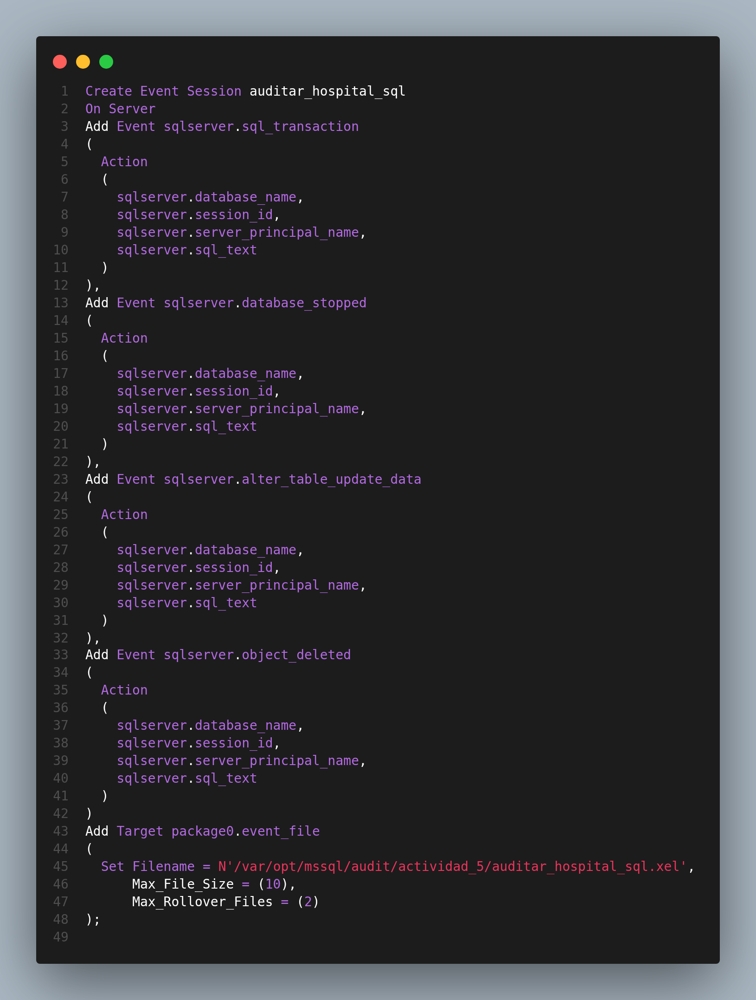

<p align="center"><em>Figura 1.39. Código utilizado para crear la sesión de eventos extendidos auditar_hospital_sql.</em></p>

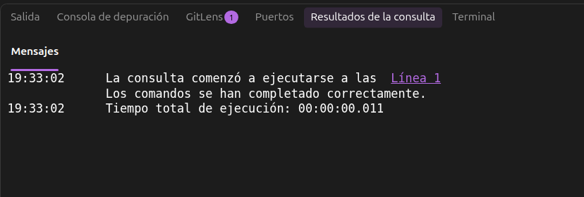

<p align="center"><em>Figura 1.40. Mensaje de ejecución correcta al crear la sesión auditar_hospital_sql.</em></p>

### Paso 20. Iniciar la sesión y generar eventos

Para no modificar la tabla `doctores`, las pruebas se realizan sobre `tbl_evento_prueba`. La tabla se crea, se modifica, se utiliza dentro de una transacción y al final se elimina.

```sql
Alter Event Session auditar_hospital_sql
On Server
State = Start;

Use hospital_sql;

Create Table dbo.tbl_evento_prueba
(
  id_registro int Primary Key
);

Insert Into dbo.tbl_evento_prueba (id_registro)
Values (1);

Alter Table dbo.tbl_evento_prueba
Add activo bit Not Null Default 1 With Values;

Begin Transaction;
Update dbo.tbl_evento_prueba
Set activo = 0
Where id_registro = 1;
Commit Transaction;

Drop Table dbo.tbl_evento_prueba;
```

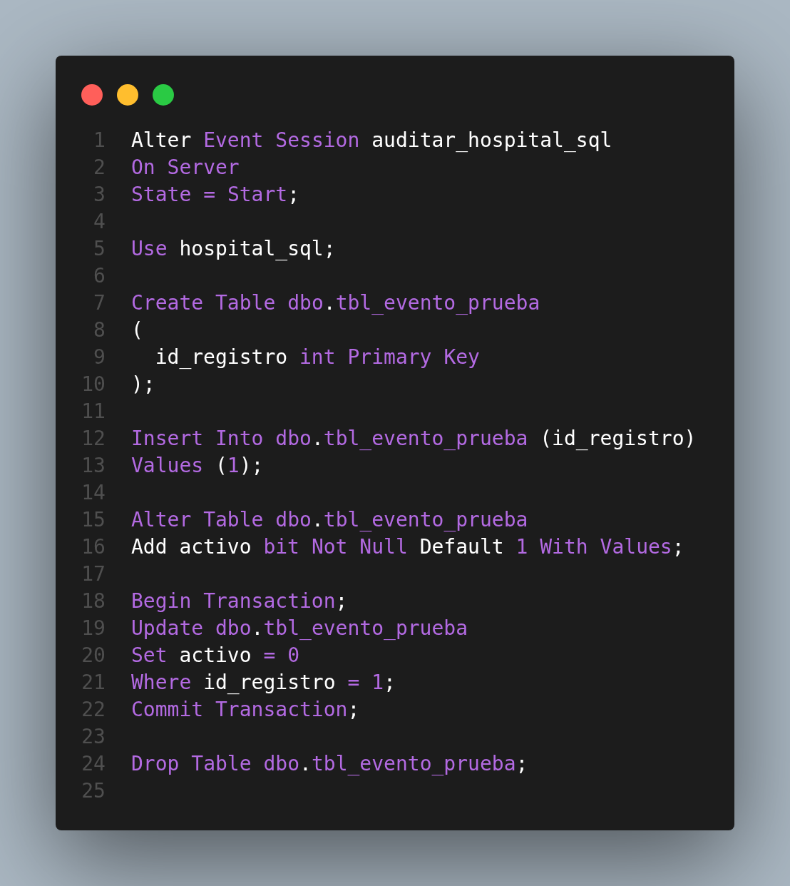

<p align="center"><em>Figura 1.41. Código utilizado para iniciar la sesión personalizada y generar eventos de prueba.</em></p>

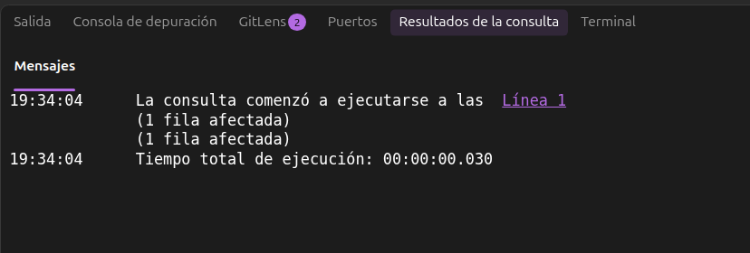

<p align="center"><em>Figura 1.42. Resultado correcto de las operaciones utilizadas para generar eventos.</em></p>

### Paso 21. Detener y consultar la sesión personalizada

Después de realizar las pruebas se detiene la sesión y se leen los eventos almacenados.

```sql
Use master;

Alter Event Session auditar_hospital_sql
On Server
State = Stop;

With eventos As
(
  Select Cast(event_data As xml) As evento
  From sys.fn_xe_file_target_read_file
  (
    '/var/opt/mssql/audit/actividad_5/auditar_hospital_sql*.xel',
    Null,
    Null,
    Null
  )
)
Select
  evento.value('(event/@timestamp)[1]', 'datetime2') As fecha,
  evento.value('(event/@name)[1]', 'varchar(100)') As evento,
  evento.value('(event/action[@name="database_name"]/value)[1]', 'varchar(100)') As base_datos,
  evento.value('(event/action[@name="server_principal_name"]/value)[1]', 'varchar(100)') As usuario,
  evento.value('(event/action[@name="sql_text"]/value)[1]', 'varchar(max)') As instruccion
From eventos
Order By fecha Desc;
```


<p align="center"><em>Figura 1.43. Código utilizado para detener y consultar la sesión personalizada.</em></p>

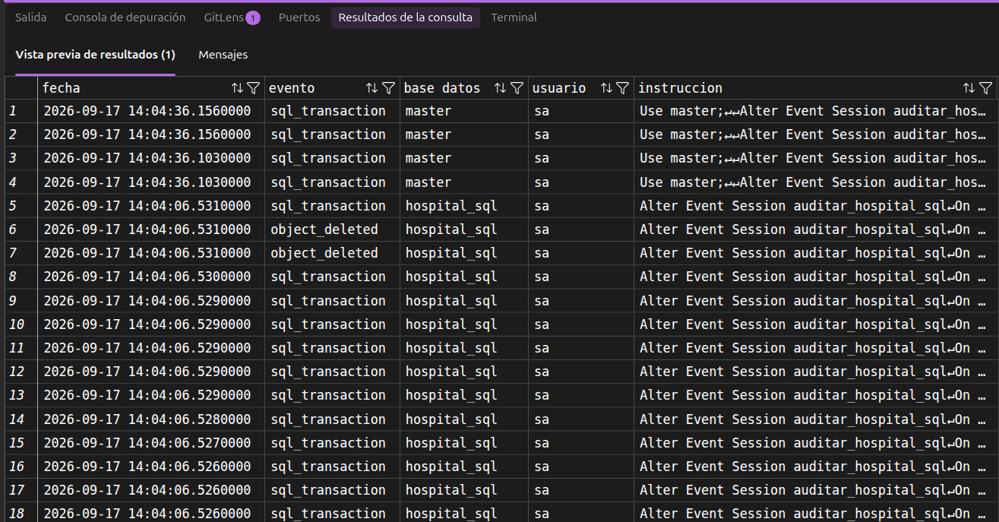

<p align="center"><em>Figura 1.44. Eventos almacenados por la sesión personalizada auditar_hospital_sql.</em></p>

## Eventos extendidos con plantilla TSQL

La plantilla TSQL de SSMS contiene eventos ya seleccionados para registrar conexiones y lotes de instrucciones. En Ubuntu no se utiliza el asistente, por lo que se crea una sesión con los mismos eventos mediante código.

### Paso 22. Crear la sesión equivalente a la plantilla

La sesión `hospital_sql_plantilla` registra conexiones existentes, inicios y cierres de sesión, procedimientos remotos y lotes T-SQL.

```sql
Create Event Session hospital_sql_plantilla
On Server
Add Event sqlserver.existing_connection
(
  Action
  (
    sqlserver.database_name,
    sqlserver.session_id,
    sqlserver.server_principal_name,
    sqlserver.sql_text
  )
),
Add Event sqlserver.login
(
  Action
  (
    sqlserver.database_name,
    sqlserver.session_id,
    sqlserver.server_principal_name,
    sqlserver.sql_text
  )
),
Add Event sqlserver.logout
(
  Action
  (
    sqlserver.database_name,
    sqlserver.session_id,
    sqlserver.server_principal_name,
    sqlserver.sql_text
  )
),
Add Event sqlserver.rpc_starting
(
  Action
  (
    sqlserver.database_name,
    sqlserver.session_id,
    sqlserver.server_principal_name,
    sqlserver.sql_text
  )
),
Add Event sqlserver.sql_batch_starting
(
  Action
  (
    sqlserver.database_name,
    sqlserver.session_id,
    sqlserver.server_principal_name,
    sqlserver.sql_text
  )
)
Add Target package0.event_file
(
  Set Filename = N'/var/opt/mssql/audit/actividad_5/hospital_sql_plantilla.xel',
      Max_File_Size = (10),
      Max_Rollover_Files = (2)
);
```

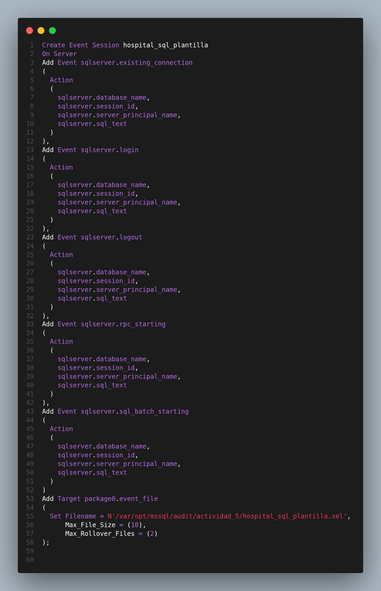

<p align="center"><em>Figura 1.45. Código utilizado para crear una sesión equivalente a la plantilla TSQL.</em></p>

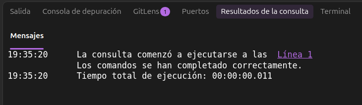

<p align="center"><em>Figura 1.46. Mensaje de ejecución correcta al crear la sesión hospital_sql_plantilla.</em></p>

### Paso 23. Iniciar la sesión y generar eventos TSQL

Se inicia la sesión y se ejecuta una consulta en `hospital_sql` para generar información.

```sql
Alter Event Session hospital_sql_plantilla
On Server
State = Start;

Use hospital_sql;

Select name
From sys.tables;
```

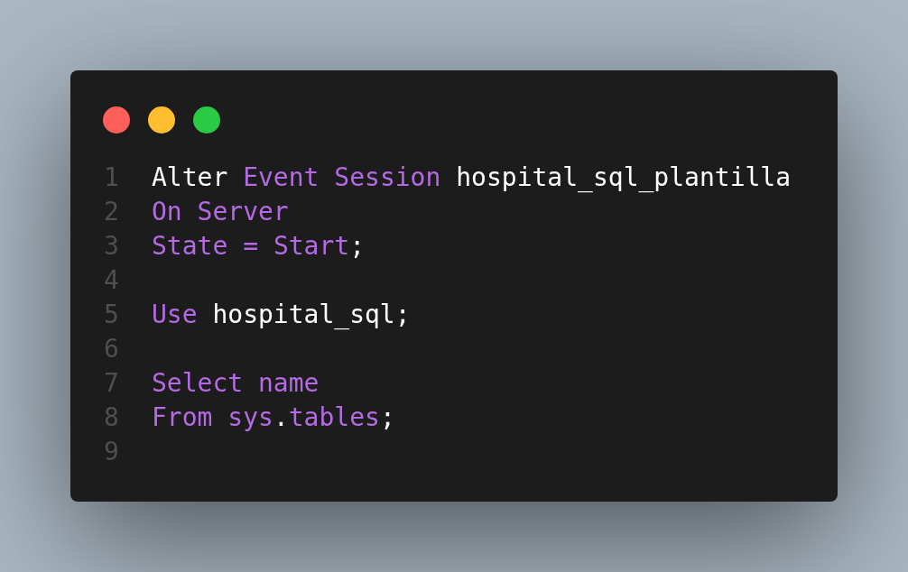

<p align="center"><em>Figura 1.47. Código utilizado para iniciar la sesión con plantilla y generar eventos TSQL.</em></p>

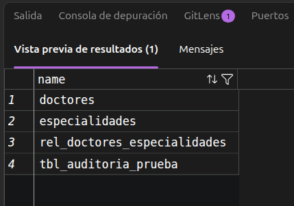

<p align="center"><em>Figura 1.48. Resultado de la consulta ejecutada para generar eventos TSQL.</em></p>

### Paso 24. Detener y consultar la sesión con plantilla

Por último, se detiene la sesión y se consulta el contenido de su archivo `.xel`.

```sql
Use master;

Alter Event Session hospital_sql_plantilla
On Server
State = Stop;

With eventos_plantilla As
(
  Select Cast(event_data As xml) As evento
  From sys.fn_xe_file_target_read_file
  (
    '/var/opt/mssql/audit/actividad_5/hospital_sql_plantilla*.xel',
    Null,
    Null,
    Null
  )
)
Select
  evento.value('(event/@timestamp)[1]', 'datetime2') As fecha,
  evento.value('(event/@name)[1]', 'varchar(100)') As evento,
  evento.value('(event/action[@name="database_name"]/value)[1]', 'varchar(100)') As base_datos,
  evento.value('(event/action[@name="server_principal_name"]/value)[1]', 'varchar(100)') As usuario,
  evento.value('(event/action[@name="sql_text"]/value)[1]', 'varchar(max)') As instruccion
From eventos_plantilla
Order By fecha Desc;
```

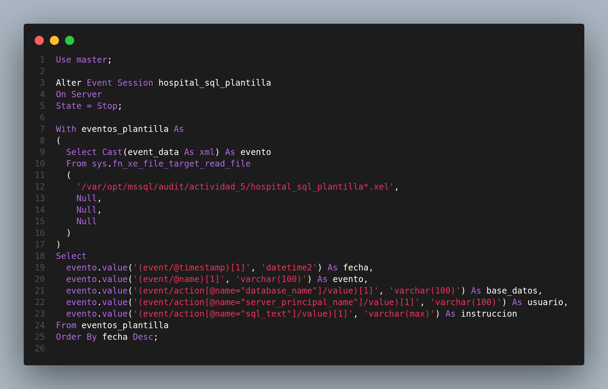

<p align="center"><em>Figura 1.49. Código utilizado para detener y consultar la sesión equivalente a la plantilla TSQL.</em></p>

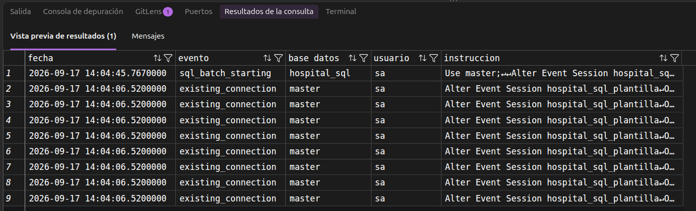

<p align="center"><em>Figura 1.50. Eventos almacenados por la sesión hospital_sql_plantilla.</em></p>

# Deshabilitar C2

El seguimiento C2 puede generar una gran cantidad de archivos y llenar el espacio del disco. Cuando se terminen de tomar las evidencias se debe deshabilitar.

```sql
Use master;

Exec sp_configure 'show advanced options', 1;
Reconfigure;

Exec sp_configure 'c2 audit mode', 0;
Reconfigure;

Select name, value, value_in_use, is_dynamic
From sys.configurations
Where name = 'c2 audit mode';
```

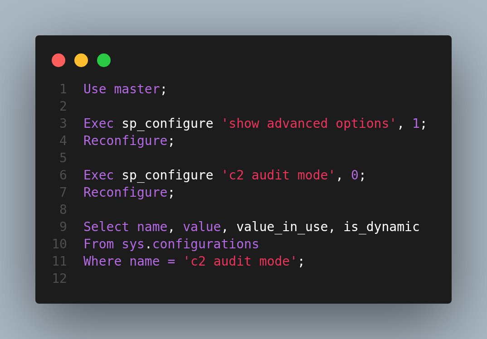

<p align="center"><em>Figura 1.51. Código utilizado para deshabilitar el seguimiento C2.</em></p>

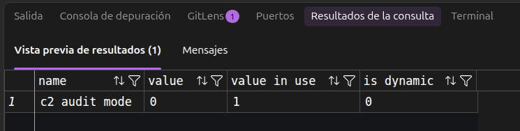

<p align="center"><em>Figura 1.52. Seguimiento C2 configurado en 0 y pendiente de aplicar mediante el reinicio de SQL Server.</em></p>


<p align="center"><em>Figura 1.53. Servicio SQL Server activo después del reinicio necesario para aplicar la desactivación de C2.</em></p>


<p align="center"><em>Figura 1.54. Comprobación final del seguimiento C2 con value y value_in_use establecidos en 0.</em></p>

Si `value_in_use` continúa en `1`, se debe reiniciar nuevamente SQL Server para aplicar el cambio.


## Evidencias


<p align="center"><em>Figura 1.55. Archivos .sqlaudit y .xel generados en el directorio de la actividad.</em></p>

## Conclusión

En esta actividad aprendi que SQL Server tiene una variedad de formas de registrar lo que sucede dentro del servidor y de una base de datos.

Aunque no se utilizó SSMS, fue posible adaptar los pasos a código T-SQL en Ubuntu. Los menús y asistentes se reemplazaron por instrucciones que crean las auditorías y las sesiones, mientras que los visores se reemplazaron por consultas a los archivos `.sqlaudit` y `.xel`. De esta forma se cumplen los mismos objetivos sin depender de la interfaz gráfica.

Las auditorías permiten conocer qué usuario realizó una acción, cuándo ocurrió, en qué base de datos se ejecutó y si fue correcta. Los eventos extendidos también permiten elegir las actividades y datos que se necesitan observar. Esto ayuda a detectar errores, revisar cambios y mantener un mayor control y seguridad sobre la información.