# Proyecto Unidad 2

Equipo: Ortega García, Núñez López y Rodríguez Macias.


## CALIDAD DE DATOS Y PYTHON EN EL ALMACÉN

Una base de datos puede tener tablas, permisos y respaldos correctos y aun así recibir información equivocada. En el caso del almacén Pepsi, un precio inválido altera el valor del inventario, un lote mal relacionado puede enviar otra bebida y una fecha incorrecta impide priorizar el producto próximo a caducar. Por eso revisamos los datos antes de utilizarlos para decidir compras y entregas.

Utilizamos datos ficticios para probar el proceso sin utilizar información real de clientes. Faker mantiene una semilla de 7 para repetir el ejercicio con la misma versión de la biblioteca; Pandas permite revisar, filtrar y transformar cada archivo (Faker, s. f.; pandas, s. f.-a, s. f.-b).

En esta versión se ejecutó la generación y la limpieza completa de los tres archivos. Se conservaron los CSV originales, las filas descartadas y los resultados de cada validación. La etapa de conexión y reintegración a SQL Server se entrega en código para ejecutarse con una cuenta autorizada.


## TABLAS SELECCIONADAS Y RELACIONES

| Tabla | Clave y relaciones | Función |
| --- | --- | --- |
| producto | PK id_producto; clave_producto única | Catálogo de bebidas, presentaciones y precios. |
| lote | PK id_lote; FK id_producto a producto; única (id_producto, numero_lote) | Identificar recepciones y caducidades. |
| inventario_lote | PK id_inventario; FK (id_lote, id_producto) a lote; FK id_almacen a almacen | Registrar las unidades del lote en el almacén. |

Se tomó la estructura de las capturas de creación de tablas del proyecto anterior, específicamente las figuras 6 y 6.1. El almacén 1 sirve como referencia auxiliar; no se genera un cuarto archivo de análisis. No se agregan columnas de ventas ni subtotales que no existían en esas tablas.


## RIESGOS Y CONTROLES DE INTEGRIDAD

| Tabla | Riesgo | Control |
| --- | --- | --- |
| producto | Un precio negativo o no numérico distorsiona la valuación. | Validar tipo y precio mayor que cero; CHECK en SQL Server. |
| lote | Una caducidad anterior a la recepción altera la salida de producto. | Comparar fechas; CHECK (fecha_caducidad > fecha_recepcion). |
| inventario_lote | Relacionar un lote con otro producto o inventar existencias. | Verificar cantidad entera no negativa y relación compuesta; FOREIGN KEY. |

Los controles se implementan en las secciones de validación de cada script y, en la versión completa, también mediante las restricciones del código T-SQL. No se convierten precios o cantidades negativos en positivos sin comprobar su valor real; se separan para revisión.


## REGLAS DE NEGOCIO POR COLUMNA

| Archivo | Columna | Regla | Obligatoriedad y relación |
| --- | --- | --- | --- |
| producto | id_producto | Entero positivo único | Obligatorio; clave primaria |
| producto | clave_producto | 1 a 15 caracteres; mayúsculas, sin espacios externos | Obligatoria y única |
| producto | nombre | 1 a 100 caracteres; formato título | Obligatorio; bebida comercializada |
| producto | presentacion | 1 a 50 caracteres; minúsculas | Obligatoria |
| producto | precio | 0.01 a 99,999,999.99; máximo dos decimales | Obligatorio; no inventar precios |
| producto | activo | Entero: 0 o 1 | Obligatorio |
| lote | id_lote | Entero positivo único | Obligatorio; clave primaria |
| lote | id_producto | Entero positivo existente en producto limpio | Obligatorio; clave foránea |
| lote | numero_lote | 1 a 30 caracteres; mayúsculas | Único junto con id_producto |
| lote | fecha_recepcion | AAAA-MM-DD; entre 01/01/2026 y 02/11/2026 | Obligatoria; fecha de recepción del ejercicio |
| lote | fecha_caducidad | AAAA-MM-DD; posterior a fecha_recepcion | Obligatoria; consistencia entre columnas |
| inventario_lote | id_inventario | Entero positivo único | Obligatorio; clave primaria |
| inventario_lote | id_almacen | Entero 1 | Almacén de referencia, sin cuarto CSV |
| inventario_lote | id_lote | Entero existente en lote limpio | Único junto con id_almacen |
| inventario_lote | id_producto | Debe coincidir con el producto del lote | Relación compuesta id_lote e id_producto |
| inventario_lote | cantidad | Entero de 0 a 2,147,483,647 | Obligatoria; no corregir signos sin evidencia |
| inventario_lote | fecha_actualizacion | AAAA-MM-DD HH:MM:SS; dentro de 2026 y hasta el corte | Obligatoria; corte 02/11/2026 23:59:59 |

Las claves enteras se limitan al rango de SQL Server INT. No se admiten nulos, texto vacío, espacios externos ni identificadores repetidos. La fecha de corte es el 2 de noviembre de 2026. La presentación se normaliza a minúsculas y las claves de producto y lote a mayúsculas.


## DIAGNÓSTICO DE LA CALIDAD DE LOS DATOS

1. ¿Qué porcentaje de registros cumple todas las reglas y permite utilizar la información del almacén?

2. ¿Qué datos obligatorios faltan y cómo impedirían identificar el producto o sus existencias?

3. ¿Existen registros o claves repetidas que puedan inflar el inventario y provocar pedidos innecesarios?

4. ¿Los precios son numéricos, positivos y válidos para calcular el valor de las existencias?

5. ¿Todos los lotes e inventarios se relacionan con productos existentes y conservan la relación entre lote y producto?

6. ¿Las fechas de recepción y caducidad son válidas y permiten decidir qué lotes deben salir primero?

7. ¿Las cantidades son enteras y no negativas, y corresponden al mismo producto y lote para sustentar el reabastecimiento?


## GENERACIÓN DE LOS TRES ARCHIVOS CSV

Cada archivo contiene 50 filas. Primero se generaron registros relacionados y después se incorporaron fallas intencionales. La última fila se reemplazó por una copia exacta de una fila existente para conservar 50 registros en lugar de aumentar el total a 51.

En producto se incluyeron seis tipos: nulos, duplicados, espacios, mayúsculas o minúsculas inconsistentes, tipos incorrectos y valores inválidos. En lote se incluyeron los nueve tipos de la consigna. En inventario_lote se incluyeron ocho: todos los aplicables, excepto mayúsculas y minúsculas porque sus columnas son numéricas o fechas.

```python
# Proyecto Unidad 2
# ? Juan Manuel Ortega García
# ! Bernardo Guillermo Núñez López
# * Carlos Gabriel Rodríguez Macias
# * 2 de noviembre de 2026

# ! Problema
# * Revisar la calidad de los productos, lotes y existencias del almacén Pepsi.
# * Los nombres y columnas se tomaron de las figuras 6 y 6.1 del proyecto 1.

# ? Importar las bibliotecas y preparar las carpetas.
import pandas as pd
from faker import Faker
from pathlib import Path
from datetime import date

ruta = Path(__file__).resolve().parent.parent
originales = ruta / 'csv_originales'
originales.mkdir(exist_ok=True)
Faker.seed(7)
fake = Faker('es_MX')

# ? Crear 50 productos de bebidas y presentaciones diferentes.
nombres = ['Pepsi', 'Mirinda', '7 Up', 'Gatorade', 'Mountain Dew']
presentaciones = ['355 ml', '600 ml', '1 litro', '1.5 litros', '2 litros',
                  '3 litros', '6 latas', '12 latas', '24 latas', '12 botellas']
datos = []
for i in range(50):
  datos.append({
    'id_producto': i + 1,
    'clave_producto': f'BEB{i + 1:03}',
    'nombre': nombres[i % 5],
    'presentacion': presentaciones[i // 5],
    'precio': fake.random_int(min=1000, max=30000) / 100,
    'activo': 1
  })
productos = pd.DataFrame(datos)

# ? Agregar nulos, espacios, mayúsculas, tipos incorrectos y valores inválidos.
# * Un precio perdido o negativo no se recupera inventando otro precio.
productos['precio'] = productos['precio'].astype('object')
productos.loc[0, 'nombre'] = None
productos.loc[1, 'nombre'] = '  Pepsi  '
productos.loc[2, 'presentacion'] = '600 ML'
productos.loc[3, 'precio'] = 'sin precio'
productos.loc[4, 'precio'] = -25
productos.loc[5, 'activo'] = 3
productos.loc[6, 'precio'] = None
productos.loc[7, 'clave_producto'] = '  beb008  '

# ? Reemplazar la última fila por una copia exacta, conservando 50 registros.
productos.loc[49] = productos.loc[20].copy()
productos.to_csv(originales / 'producto.csv', index=False, encoding='utf-8-sig')

# ? Crear 50 lotes relacionados con productos existentes antes de introducir fallas.
datos = []
for i in range(50):
  recepcion = fake.date_between(date(2026, 1, 1), date(2026, 9, 30))
  datos.append({
    'id_lote': i + 1,
    'id_producto': (i % 49) + 1,
    'numero_lote': f'LOT{i + 1:03}',
    'fecha_recepcion': recepcion.isoformat(),
    'fecha_caducidad': date(2027, recepcion.month, recepcion.day).isoformat()
  })
lotes = pd.DataFrame(datos)
lotes['id_producto'] = lotes['id_producto'].astype('object')

# ? Introducir los nueve tipos de error que aplican a los lotes.
lotes.loc[0, 'numero_lote'] = None
lotes.loc[1, 'numero_lote'] = '  LOT002  '
lotes.loc[2, 'numero_lote'] = 'lot003'
lotes.loc[3, 'fecha_recepcion'] = '15/03/2026'
lotes.loc[4, 'id_producto'] = 'producto cinco'
lotes.loc[5, 'id_producto'] = 999
lotes.loc[6, 'fecha_caducidad'] = '2025-01-01'
lotes.loc[7, 'fecha_recepcion'] = '2026-02-30'
lotes.loc[8, 'fecha_recepcion'] = '2025-12-01'
lotes.loc[49] = lotes.loc[20].copy()
lotes.to_csv(originales / 'lote.csv', index=False, encoding='utf-8-sig')

# ? Crear 50 registros de inventario para el almacén 1.
# * Se conserva la relación compuesta id_lote e id_producto de la captura original.
datos = []
for i in range(50):
  datos.append({
    'id_inventario': i + 1,
    'id_almacen': 1,
    'id_lote': i + 1,
    'id_producto': (i % 49) + 1,
    'cantidad': fake.random_int(min=0, max=500),
    'fecha_actualizacion': '2026-10-31 12:00:00'
  })
inventario = pd.DataFrame(datos)
inventario['cantidad'] = inventario['cantidad'].astype('object')

# ? Agregar errores de cantidad, fechas y relaciones sin inventar columnas nuevas.
# * No se prueba mayúsculas en columnas numéricas porque no corresponde.
inventario.loc[0, 'cantidad'] = None
inventario.loc[1, 'fecha_actualizacion'] = ' 2026-10-31 12:00:00 '
inventario.loc[2, 'fecha_actualizacion'] = '31/10/2026 12:00:00'
inventario.loc[3, 'cantidad'] = 'muchas'
inventario.loc[4, 'cantidad'] = -12
inventario.loc[5, 'id_lote'] = 999
inventario.loc[6, 'id_producto'] = 40
inventario.loc[7, 'fecha_actualizacion'] = '2026-02-30 12:00:00'
inventario.loc[8, 'cantidad'] = 1.5
inventario.loc[49] = inventario.loc[20].copy()
inventario.to_csv(originales / 'inventario_lote.csv', index=False, encoding='utf-8-sig')

# ? Comprobar que los tres CSV contienen exactamente 50 filas.
print('Ortega García - Núñez López - Rodríguez Macias')
print('producto:', len(productos), 'registros')
print('lote:', len(lotes), 'registros')
print('inventario_lote:', len(inventario), 'registros')


```

Seleccionamos estos errores porque pueden surgir al copiar catálogos, repetir una carga, omitir campos, escribir un precio con texto o capturar una fecha con otra configuración regional. Una relación rota puede aparecer cuando el archivo de existencias llega antes que su catálogo. La discrepancia entre lote y producto simula seleccionar una bebida distinta durante la captura del almacén.

| Error | Por qué se prueba | Ejemplo en producción |
| --- | --- | --- |
| Valor nulo | Comprobar campos obligatorios. | Se omite el nombre del producto o su cantidad al capturar. |
| Duplicado exacto | Evitar contar dos veces la misma información. | Se vuelve a cargar el archivo de una recepción. |
| Espacios externos | Evitar diferencias falsas al comparar textos. | Se copia una clave desde una hoja de cálculo. |
| Mayúsculas y minúsculas | Homologar claves y presentaciones. | Dos operadores escriben LOT003 y lot003. |
| Formato de fecha | Interpretar correctamente recepción y caducidad. | Una estación exporta día/mes/año y otra año-mes-día. |
| Tipo incorrecto | Detectar texto donde se requiere un número. | Se escribe muchas en la cantidad o sin precio en el catálogo. |
| Valor inválido | Impedir precios negativos, fechas imposibles o cantidades fraccionarias. | Un error de signo registra -12 unidades disponibles. |
| Relación rota | Mantener la trazabilidad entre archivos. | Llega una existencia que apunta a un lote no registrado. |
| Inconsistencia entre columnas | Comprobar que los campos sean compatibles. | El lote pertenece a otra bebida o caduca antes de su recepción. |


## LECTURA Y BÚSQUEDA DE ERRORES

Cada tabla cuenta con su propio archivo Python. Se utiliza try-except para avisar si falta el CSV y no continuar con datos inexistentes. info() muestra columnas y tipos; shape muestra filas y columnas; head() permite inspeccionar una muestra. La versión completa también emplea describe(include="all") para revisar valores frecuentes y distribución.

Los errores se buscan por reglas sobre todas las filas; las posiciones usadas por el generador no se utilizan para decidir cuáles registros limpiar. Los valores que no se pueden convertir se detectan con errores controlados en lugar de detener el análisis (pandas, s. f.-a, s. f.-b).

```python
# Proyecto Unidad 2
# ? Juan Manuel Ortega García
# ! Bernardo Guillermo Núñez López
# * Carlos Gabriel Rodríguez Macias
# * 2 de noviembre de 2026

# ? Importar el CSV y controlar la ausencia del archivo o de sus referencias.
import pandas as pd
from pathlib import Path

ruta = Path(__file__).resolve().parent.parent
try:
  datos_csv = pd.read_csv(ruta / 'csv_originales' / 'producto.csv', dtype='string')
except (FileNotFoundError, pd.errors.EmptyDataError, pd.errors.ParserError) as error:
  print('No se pudo leer el archivo:', error)
  raise SystemExit(1)

# ? Mostrar la estructura, dimensiones y estadísticas antes de limpiar.
print('Ortega García - Núñez López - Rodríguez Macias')
datos_csv.info()
print('Dimensiones:', datos_csv.shape)
print(datos_csv.describe(include='all'))

# ? Buscar errores por reglas generales, sin usar las posiciones de las fallas.
# * Esta función se ejecuta antes y después con las mismas reglas.
def validar(datos):
  errores = pd.DataFrame(index=datos.index)
  for columna in datos.columns:
    errores[columna + '_nulo'] = datos[columna].isna() | datos[columna].str.strip().eq('').fillna(False)
    errores[columna + '_espacios'] = datos[columna].ne(datos[columna].str.strip()).fillna(False)
  errores['duplicado_exacto'] = datos.duplicated(keep=False)
  errores['clave_primaria_repetida'] = datos.duplicated(subset=['id_producto'], keep=False)
  numeros = {}
  fechas = {}
  numeros['id_producto'] = pd.to_numeric(datos['id_producto'], errors='coerce')
  errores['id_producto_tipo'] = numeros['id_producto'].isna() | numeros['id_producto'].isin([float('inf'), -float('inf')])
  numeros['precio'] = pd.to_numeric(datos['precio'], errors='coerce')
  errores['precio_tipo'] = numeros['precio'].isna() | numeros['precio'].isin([float('inf'), -float('inf')])
  numeros['activo'] = pd.to_numeric(datos['activo'], errors='coerce')
  errores['activo_tipo'] = numeros['activo'].isna() | numeros['activo'].isin([float('inf'), -float('inf')])
  errores['clave_producto_formato'] = datos['clave_producto'].ne(datos['clave_producto'].str.strip().str.upper()).fillna(False)
  errores['nombre_formato'] = datos['nombre'].ne(datos['nombre'].str.strip().str.title()).fillna(False)
  errores['presentacion_formato'] = datos['presentacion'].ne(datos['presentacion'].str.strip().str.lower()).fillna(False)
  errores['clave_producto_longitud'] = datos['clave_producto'].str.len().gt(15).fillna(False)
  errores['nombre_longitud'] = datos['nombre'].str.len().gt(100).fillna(False)
  errores['presentacion_longitud'] = datos['presentacion'].str.len().gt(50).fillna(False)
  errores['clave_negocio_1_repetida'] = datos.duplicated(subset=['clave_producto'], keep=False)

  errores['id_producto_invalido'] = ~numeros['id_producto'].between(1, 2147483647) | numeros['id_producto'].mod(1).ne(0)
  errores['precio_invalido'] = ~numeros['precio'].between(0.01, 99999999.99)
  errores['precio_decimales'] = numeros['precio'].sub(numeros['precio'].round(2)).abs().gt(0.000001)
  errores['activo_invalido'] = ~numeros['activo'].isin([0, 1])
  return errores.fillna(False)

# ? Contar filas aptas una sola vez aunque tengan varios errores.
antes = validar(datos_csv)
no_aptos = antes.any(axis=1)
print('Errores por regla:')
print(antes.sum())
print('Filas afectadas:')
print(datos_csv.loc[no_aptos].to_string(index=False))
original = datos_csv.copy()

# ? Normalizar texto y conservar el original para comparar los cambios.
limpios = datos_csv.copy()
for columna in limpios.columns:
  limpios[columna] = limpios[columna].str.strip()
limpios['clave_producto'] = limpios['clave_producto'].str.upper()
limpios['nombre'] = limpios['nombre'].str.title()
limpios['presentacion'] = limpios['presentacion'].str.lower()


# ? Retirar únicamente las repeticiones exactas y separar filas sin solución comprobable.
limpios = limpios.drop_duplicates(keep='first').copy()
pendientes = validar(limpios).any(axis=1)
limpios = limpios.loc[~pendientes].copy()
despues = validar(limpios)
if despues.any(axis=1).any():
  raise ValueError('Todavía existen errores; no se exportará como archivo limpio.')

# ? Registrar conservados, corregidos y descartados sin contar una fila dos veces.
conservados = len(limpios)
descartados = len(original) - conservados
modificados = original.loc[limpios.index].fillna('').ne(limpios.fillna('')).any(axis=1)
corregidos = int(modificados.sum())
sin_cambios = conservados - corregidos
resumen = pd.DataFrame([{
  'archivo': 'producto', 'iniciales': len(original),
  'aptos_antes': int((~no_aptos).sum()), 'no_aptos_antes': int(no_aptos.sum()),
  'porcentaje_apto_antes': round((~no_aptos).mean() * 100, 2),
  'porcentaje_no_apto_antes': round(no_aptos.mean() * 100, 2),
  'conservados': conservados, 'corregidos': corregidos,
  'sin_cambios': sin_cambios, 'descartados': descartados,
  'aptos_despues': conservados, 'no_aptos_despues': 0,
  'porcentaje_apto_despues': 100.0 if conservados else 0.0,
  'porcentaje_no_apto_despues': 0.0
}])
print('Resumen de calidad:')
for columna, valor in resumen.iloc[0].items():
  print(f'{columna}: {valor}')

# ? Guardar los hallazgos por fila y los archivos listos para SQL Server.
hallazgos = antes.copy()
hallazgos.insert(0, 'fila_csv', original.index + 2)
hallazgos.to_csv(ruta / 'resultados' / 'producto_errores.csv', index=False)
descartes = original.loc[~original.index.isin(limpios.index)].copy()
descartes.insert(0, 'fila_csv', descartes.index + 2)
descartes.to_csv(ruta / 'resultados' / 'producto_descartados.csv', index=False)
resumen.to_csv(ruta / 'resultados' / 'producto_resumen.csv', index=False)
for columna in ['id_producto','activo']:
  limpios[columna] = pd.to_numeric(limpios[columna]).astype('int64')
limpios['precio'] = pd.to_numeric(limpios['precio']).round(2)
limpios.to_csv(ruta / 'csv_limpios' / 'producto.csv', index=False, encoding='utf-8-sig')
print('Validación final: 0 filas no aptas.')


```

```python
# Proyecto Unidad 2
# ? Juan Manuel Ortega García
# ! Bernardo Guillermo Núñez López
# * Carlos Gabriel Rodríguez Macias
# * 2 de noviembre de 2026

# ? Importar el CSV y controlar la ausencia del archivo o de sus referencias.
import pandas as pd
from pathlib import Path

ruta = Path(__file__).resolve().parent.parent
try:
  datos_csv = pd.read_csv(ruta / 'csv_originales' / 'lote.csv', dtype='string')
  productos = pd.read_csv(ruta / 'csv_limpios' / 'producto.csv')
except (FileNotFoundError, pd.errors.EmptyDataError, pd.errors.ParserError) as error:
  print('No se pudo leer el archivo:', error)
  raise SystemExit(1)

# ? Mostrar la estructura, dimensiones y estadísticas antes de limpiar.
print('Ortega García - Núñez López - Rodríguez Macias')
datos_csv.info()
print('Dimensiones:', datos_csv.shape)
print(datos_csv.describe(include='all'))

# ? Buscar errores por reglas generales, sin usar las posiciones de las fallas.
# * Esta función se ejecuta antes y después con las mismas reglas.
def validar(datos):
  errores = pd.DataFrame(index=datos.index)
  for columna in datos.columns:
    errores[columna + '_nulo'] = datos[columna].isna() | datos[columna].str.strip().eq('').fillna(False)
    errores[columna + '_espacios'] = datos[columna].ne(datos[columna].str.strip()).fillna(False)
  errores['duplicado_exacto'] = datos.duplicated(keep=False)
  errores['clave_primaria_repetida'] = datos.duplicated(subset=['id_lote'], keep=False)
  numeros = {}
  fechas = {}
  numeros['id_lote'] = pd.to_numeric(datos['id_lote'], errors='coerce')
  errores['id_lote_tipo'] = numeros['id_lote'].isna() | numeros['id_lote'].isin([float('inf'), -float('inf')])
  numeros['id_producto'] = pd.to_numeric(datos['id_producto'], errors='coerce')
  errores['id_producto_tipo'] = numeros['id_producto'].isna() | numeros['id_producto'].isin([float('inf'), -float('inf')])
  errores['numero_lote_formato'] = datos['numero_lote'].ne(datos['numero_lote'].str.strip().str.upper()).fillna(False)
  errores['numero_lote_longitud'] = datos['numero_lote'].str.len().gt(30).fillna(False)
  errores['clave_negocio_1_repetida'] = datos.duplicated(subset=['id_producto','numero_lote'], keep=False)
  fechas['fecha_recepcion'] = pd.to_datetime(datos['fecha_recepcion'], format='%Y-%m-%d', errors='coerce')
  errores['fecha_recepcion_invalida'] = fechas['fecha_recepcion'].isna()
  errores['fecha_recepcion_formato'] = datos['fecha_recepcion'].ne(fechas['fecha_recepcion'].dt.strftime('%Y-%m-%d')).fillna(True)
  fechas['fecha_caducidad'] = pd.to_datetime(datos['fecha_caducidad'], format='%Y-%m-%d', errors='coerce')
  errores['fecha_caducidad_invalida'] = fechas['fecha_caducidad'].isna()
  errores['fecha_caducidad_formato'] = datos['fecha_caducidad'].ne(fechas['fecha_caducidad'].dt.strftime('%Y-%m-%d')).fillna(True)
  for columna in ['id_lote', 'id_producto']:
    errores[columna + '_invalido'] = ~numeros[columna].between(1, 2147483647) | numeros[columna].mod(1).ne(0)
  errores['producto_inexistente'] = ~numeros['id_producto'].isin(productos['id_producto'])
  errores['recepcion_fuera_periodo'] = ~fechas['fecha_recepcion'].between('2026-01-01', '2026-11-02')
  errores['caducidad_antes_recepcion'] = fechas['fecha_caducidad'].le(fechas['fecha_recepcion'])
  return errores.fillna(False)

# ? Contar filas aptas una sola vez aunque tengan varios errores.
antes = validar(datos_csv)
no_aptos = antes.any(axis=1)
print('Errores por regla:')
print(antes.sum())
print('Filas afectadas:')
print(datos_csv.loc[no_aptos].to_string(index=False))
original = datos_csv.copy()

# ? Normalizar texto y conservar el original para comparar los cambios.
limpios = datos_csv.copy()
for columna in limpios.columns:
  limpios[columna] = limpios[columna].str.strip()
limpios['numero_lote'] = limpios['numero_lote'].str.upper()
# * Aceptar dos formatos conocidos sin adivinar el orden de día y mes.
fechas = pd.to_datetime(limpios['fecha_recepcion'], format='%Y-%m-%d', errors='coerce')
alternativas = pd.to_datetime(limpios['fecha_recepcion'], format='%d/%m/%Y', errors='coerce')
limpios['fecha_recepcion'] = fechas.fillna(alternativas).dt.strftime('%Y-%m-%d').astype('string')
# * Aceptar dos formatos conocidos sin adivinar el orden de día y mes.
fechas = pd.to_datetime(limpios['fecha_caducidad'], format='%Y-%m-%d', errors='coerce')
alternativas = pd.to_datetime(limpios['fecha_caducidad'], format='%d/%m/%Y', errors='coerce')
limpios['fecha_caducidad'] = fechas.fillna(alternativas).dt.strftime('%Y-%m-%d').astype('string')

# ? Retirar únicamente las repeticiones exactas y separar filas sin solución comprobable.
limpios = limpios.drop_duplicates(keep='first').copy()
pendientes = validar(limpios).any(axis=1)
limpios = limpios.loc[~pendientes].copy()
despues = validar(limpios)
if despues.any(axis=1).any():
  raise ValueError('Todavía existen errores; no se exportará como archivo limpio.')

# ? Registrar conservados, corregidos y descartados sin contar una fila dos veces.
conservados = len(limpios)
descartados = len(original) - conservados
modificados = original.loc[limpios.index].fillna('').ne(limpios.fillna('')).any(axis=1)
corregidos = int(modificados.sum())
sin_cambios = conservados - corregidos
resumen = pd.DataFrame([{
  'archivo': 'lote', 'iniciales': len(original),
  'aptos_antes': int((~no_aptos).sum()), 'no_aptos_antes': int(no_aptos.sum()),
  'porcentaje_apto_antes': round((~no_aptos).mean() * 100, 2),
  'porcentaje_no_apto_antes': round(no_aptos.mean() * 100, 2),
  'conservados': conservados, 'corregidos': corregidos,
  'sin_cambios': sin_cambios, 'descartados': descartados,
  'aptos_despues': conservados, 'no_aptos_despues': 0,
  'porcentaje_apto_despues': 100.0 if conservados else 0.0,
  'porcentaje_no_apto_despues': 0.0
}])
print('Resumen de calidad:')
for columna, valor in resumen.iloc[0].items():
  print(f'{columna}: {valor}')

# ? Guardar los hallazgos por fila y los archivos listos para SQL Server.
hallazgos = antes.copy()
hallazgos.insert(0, 'fila_csv', original.index + 2)
hallazgos.to_csv(ruta / 'resultados' / 'lote_errores.csv', index=False)
descartes = original.loc[~original.index.isin(limpios.index)].copy()
descartes.insert(0, 'fila_csv', descartes.index + 2)
descartes.to_csv(ruta / 'resultados' / 'lote_descartados.csv', index=False)
resumen.to_csv(ruta / 'resultados' / 'lote_resumen.csv', index=False)
for columna in ['id_lote','id_producto']:
  limpios[columna] = pd.to_numeric(limpios[columna]).astype('int64')
limpios.to_csv(ruta / 'csv_limpios' / 'lote.csv', index=False, encoding='utf-8-sig')
print('Validación final: 0 filas no aptas.')


```

```python
# Proyecto Unidad 2
# ? Juan Manuel Ortega García
# ! Bernardo Guillermo Núñez López
# * Carlos Gabriel Rodríguez Macias
# * 2 de noviembre de 2026

# ? Importar el CSV y controlar la ausencia del archivo o de sus referencias.
import pandas as pd
from pathlib import Path

ruta = Path(__file__).resolve().parent.parent
try:
  datos_csv = pd.read_csv(ruta / 'csv_originales' / 'inventario_lote.csv', dtype='string')
  productos = pd.read_csv(ruta / 'csv_limpios' / 'producto.csv')
  lotes = pd.read_csv(ruta / 'csv_limpios' / 'lote.csv')
except (FileNotFoundError, pd.errors.EmptyDataError, pd.errors.ParserError) as error:
  print('No se pudo leer el archivo:', error)
  raise SystemExit(1)

# ? Mostrar la estructura, dimensiones y estadísticas antes de limpiar.
print('Ortega García - Núñez López - Rodríguez Macias')
datos_csv.info()
print('Dimensiones:', datos_csv.shape)
print(datos_csv.describe(include='all'))

# ? Buscar errores por reglas generales, sin usar las posiciones de las fallas.
# * Esta función se ejecuta antes y después con las mismas reglas.
def validar(datos):
  errores = pd.DataFrame(index=datos.index)
  for columna in datos.columns:
    errores[columna + '_nulo'] = datos[columna].isna() | datos[columna].str.strip().eq('').fillna(False)
    errores[columna + '_espacios'] = datos[columna].ne(datos[columna].str.strip()).fillna(False)
  errores['duplicado_exacto'] = datos.duplicated(keep=False)
  errores['clave_primaria_repetida'] = datos.duplicated(subset=['id_inventario'], keep=False)
  numeros = {}
  fechas = {}
  numeros['id_inventario'] = pd.to_numeric(datos['id_inventario'], errors='coerce')
  errores['id_inventario_tipo'] = numeros['id_inventario'].isna() | numeros['id_inventario'].isin([float('inf'), -float('inf')])
  numeros['id_almacen'] = pd.to_numeric(datos['id_almacen'], errors='coerce')
  errores['id_almacen_tipo'] = numeros['id_almacen'].isna() | numeros['id_almacen'].isin([float('inf'), -float('inf')])
  numeros['id_lote'] = pd.to_numeric(datos['id_lote'], errors='coerce')
  errores['id_lote_tipo'] = numeros['id_lote'].isna() | numeros['id_lote'].isin([float('inf'), -float('inf')])
  numeros['id_producto'] = pd.to_numeric(datos['id_producto'], errors='coerce')
  errores['id_producto_tipo'] = numeros['id_producto'].isna() | numeros['id_producto'].isin([float('inf'), -float('inf')])
  numeros['cantidad'] = pd.to_numeric(datos['cantidad'], errors='coerce')
  errores['cantidad_tipo'] = numeros['cantidad'].isna() | numeros['cantidad'].isin([float('inf'), -float('inf')])


  errores['clave_negocio_1_repetida'] = datos.duplicated(subset=['id_almacen','id_lote'], keep=False)
  fechas['fecha_actualizacion'] = pd.to_datetime(datos['fecha_actualizacion'], format='%Y-%m-%d %H:%M:%S', errors='coerce')
  errores['fecha_actualizacion_invalida'] = fechas['fecha_actualizacion'].isna()
  errores['fecha_actualizacion_formato'] = datos['fecha_actualizacion'].ne(fechas['fecha_actualizacion'].dt.strftime('%Y-%m-%d %H:%M:%S')).fillna(True)
  for columna in ['id_inventario', 'id_almacen', 'id_lote', 'id_producto']:
    errores[columna + '_invalido'] = ~numeros[columna].between(1, 2147483647) | numeros[columna].mod(1).ne(0)
  errores['cantidad_invalida'] = ~numeros['cantidad'].between(0, 2147483647) | numeros['cantidad'].mod(1).ne(0)
  errores['almacen_inexistente'] = ~numeros['id_almacen'].isin([1])
  errores['producto_inexistente'] = ~numeros['id_producto'].isin(productos['id_producto'])
  errores['lote_inexistente'] = ~numeros['id_lote'].isin(lotes['id_lote'])
  producto_por_lote = lotes.set_index('id_lote')['id_producto']
  errores['producto_no_corresponde_lote'] = numeros['id_producto'].ne(numeros['id_lote'].map(producto_por_lote))
  errores['actualizacion_fuera_periodo'] = ~fechas['fecha_actualizacion'].between('2026-01-01', '2026-11-02 23:59:59')
  return errores.fillna(False)

# ? Contar filas aptas una sola vez aunque tengan varios errores.
antes = validar(datos_csv)
no_aptos = antes.any(axis=1)
print('Errores por regla:')
print(antes.sum())
print('Filas afectadas:')
print(datos_csv.loc[no_aptos].to_string(index=False))
original = datos_csv.copy()

# ? Normalizar texto y conservar el original para comparar los cambios.
limpios = datos_csv.copy()
for columna in limpios.columns:
  limpios[columna] = limpios[columna].str.strip()

# * Aceptar dos formatos conocidos sin adivinar el orden de día y mes.
fechas = pd.to_datetime(limpios['fecha_actualizacion'], format='%Y-%m-%d %H:%M:%S', errors='coerce')
alternativas = pd.to_datetime(limpios['fecha_actualizacion'], format='%d/%m/%Y %H:%M:%S', errors='coerce')
limpios['fecha_actualizacion'] = fechas.fillna(alternativas).dt.strftime('%Y-%m-%d %H:%M:%S').astype('string')

# ? Retirar únicamente las repeticiones exactas y separar filas sin solución comprobable.
limpios = limpios.drop_duplicates(keep='first').copy()
pendientes = validar(limpios).any(axis=1)
limpios = limpios.loc[~pendientes].copy()
despues = validar(limpios)
if despues.any(axis=1).any():
  raise ValueError('Todavía existen errores; no se exportará como archivo limpio.')

# ? Registrar conservados, corregidos y descartados sin contar una fila dos veces.
conservados = len(limpios)
descartados = len(original) - conservados
modificados = original.loc[limpios.index].fillna('').ne(limpios.fillna('')).any(axis=1)
corregidos = int(modificados.sum())
sin_cambios = conservados - corregidos
resumen = pd.DataFrame([{
  'archivo': 'inventario_lote', 'iniciales': len(original),
  'aptos_antes': int((~no_aptos).sum()), 'no_aptos_antes': int(no_aptos.sum()),
  'porcentaje_apto_antes': round((~no_aptos).mean() * 100, 2),
  'porcentaje_no_apto_antes': round(no_aptos.mean() * 100, 2),
  'conservados': conservados, 'corregidos': corregidos,
  'sin_cambios': sin_cambios, 'descartados': descartados,
  'aptos_despues': conservados, 'no_aptos_despues': 0,
  'porcentaje_apto_despues': 100.0 if conservados else 0.0,
  'porcentaje_no_apto_despues': 0.0
}])
print('Resumen de calidad:')
for columna, valor in resumen.iloc[0].items():
  print(f'{columna}: {valor}')

# ? Guardar los hallazgos por fila y los archivos listos para SQL Server.
hallazgos = antes.copy()
hallazgos.insert(0, 'fila_csv', original.index + 2)
hallazgos.to_csv(ruta / 'resultados' / 'inventario_lote_errores.csv', index=False)
descartes = original.loc[~original.index.isin(limpios.index)].copy()
descartes.insert(0, 'fila_csv', descartes.index + 2)
descartes.to_csv(ruta / 'resultados' / 'inventario_lote_descartados.csv', index=False)
resumen.to_csv(ruta / 'resultados' / 'inventario_lote_resumen.csv', index=False)
for columna in ['id_inventario','id_almacen','id_lote','id_producto','cantidad']:
  limpios[columna] = pd.to_numeric(limpios[columna]).astype('int64')
limpios.to_csv(ruta / 'csv_limpios' / 'inventario_lote.csv', index=False, encoding='utf-8-sig')
print('Validación final: 0 filas no aptas.')


```


## LIMPIEZA Y TRANSFORMACIÓN MEDIANTE ETL

ETL consiste en extraer los datos, transformarlos y cargarlos en un destino. En este proyecto la extracción lee los CSV originales, la transformación detecta y corrige inconsistencias comprobables y la carga reintegra los archivos aptos en SQL Server. Este orden evita trasladar fallas del archivo de origen al sistema operativo del almacén (Microsoft, s. f.-b).

Se recortaron espacios, se uniformaron textos y se convirtieron dos formatos de fecha conocidos. Se conservó una sola copia de cada duplicado exacto. Los registros con nulos obligatorios, importes no recuperables, cantidades inválidas o relaciones rotas se descartaron del archivo apto, pero permanecen en los archivos de revisión. Los lotes e inventarios se compararon contra sus referencias ya limpias.

Una fila puede incumplir varias reglas. Para calcular aptos y no aptos se utiliza una condición por fila, de manera que no se suman los errores como si fueran registros diferentes. Después de limpiar se ejecuta la misma función de validación.

| Archivo y error | Columna | Filas CSV | Operación | Consecuencia |
| --- | --- | --- | --- | --- |
| producto: clave_producto_espacios | clave_producto | 9 | Normalizar texto | Conteo o valor del inventario incorrecto |
| producto: nombre_nulo | nombre | 2 | Separar registro si no es recuperable | Conteo o valor del inventario incorrecto |
| producto: nombre_espacios | nombre | 3 | Normalizar texto | Conteo o valor del inventario incorrecto |
| producto: precio_nulo | precio | 8 | Separar registro si no es recuperable | Conteo o valor del inventario incorrecto |
| producto: duplicado_exacto | Todas | 22, 51 | Conservar una copia; revisar claves | Conteo o valor del inventario incorrecto |
| producto: clave_primaria_repetida | id_producto | 22, 51 | Conservar una copia; revisar claves | Conteo o valor del inventario incorrecto |
| producto: precio_tipo | precio | 5, 8 | Separar registro si no es recuperable | Conteo o valor del inventario incorrecto |
| producto: clave_producto_formato | clave_producto | 9 | Normalizar texto | Conteo o valor del inventario incorrecto |
| producto: nombre_formato | nombre | 3 | Normalizar texto | Conteo o valor del inventario incorrecto |
| producto: presentacion_formato | presentacion | 4 | Normalizar texto | Conteo o valor del inventario incorrecto |
| producto: clave_negocio_1_repetida | clave_producto | 22, 51 | Conservar una copia; revisar claves | Conteo o valor del inventario incorrecto |
| producto: precio_invalido | precio | 6 | Separar registro si no es recuperable | Conteo o valor del inventario incorrecto |
| producto: activo_invalido | activo | 7 | Separar registro si no es recuperable | Conteo o valor del inventario incorrecto |
| lote: numero_lote_nulo | numero_lote | 2 | Separar registro si no es recuperable | Trazabilidad o caducidad incorrecta |
| lote: numero_lote_espacios | numero_lote | 3 | Normalizar texto | Trazabilidad o caducidad incorrecta |
| lote: duplicado_exacto | Todas | 22, 51 | Conservar una copia; revisar claves | Trazabilidad o caducidad incorrecta |
| lote: clave_primaria_repetida | id_lote | 22, 51 | Conservar una copia; revisar claves | Trazabilidad o caducidad incorrecta |
| lote: id_producto_tipo | id_producto | 6 | Separar registro si no es recuperable | Trazabilidad o caducidad incorrecta |
| lote: numero_lote_formato | numero_lote | 3, 4 | Normalizar texto | Trazabilidad o caducidad incorrecta |
| lote: clave_negocio_1_repetida | id_producto / numero_lote | 22, 51 | Conservar una copia; revisar claves | Trazabilidad o caducidad incorrecta |
| lote: fecha_recepcion_invalida | fecha_recepcion | 5, 9 | Separar registro si no es recuperable | Trazabilidad o caducidad incorrecta |
| lote: fecha_recepcion_formato | fecha_recepcion | 5, 9 | Normalizar texto | Trazabilidad o caducidad incorrecta |
| lote: producto_inexistente | id_producto | 2, 5, 6, 7, 8 | Separar registro si no es recuperable | Trazabilidad o caducidad incorrecta |
| lote: recepcion_fuera_periodo | fecha_recepcion | 5, 9, 10 | Separar registro si no es recuperable | Trazabilidad o caducidad incorrecta |
| lote: caducidad_antes_recepcion | fecha_recepcion / fecha_caducidad | 8 | Separar registro si no es recuperable | Trazabilidad o caducidad incorrecta |
| inventario_lote: cantidad_nulo | cantidad | 2 | Separar registro si no es recuperable | Conteo o valor del inventario incorrecto |
| inventario_lote: fecha_actualizacion_espacios | fecha_actualizacion | 3 | Normalizar texto | Conteo o valor del inventario incorrecto |
| inventario_lote: duplicado_exacto | Todas | 22, 51 | Conservar una copia; revisar claves | Conteo o valor del inventario incorrecto |
| inventario_lote: clave_primaria_repetida | id_inventario | 22, 51 | Conservar una copia; revisar claves | Conteo o valor del inventario incorrecto |
| inventario_lote: cantidad_tipo | cantidad | 2, 5 | Separar registro si no es recuperable | Conteo o valor del inventario incorrecto |
| inventario_lote: clave_negocio_1_repetida | id_almacen / id_lote | 22, 51 | Conservar una copia; revisar claves | Conteo o valor del inventario incorrecto |
| inventario_lote: fecha_actualizacion_invalida | fecha_actualizacion | 3, 4, 9 | Separar registro si no es recuperable | Conteo o valor del inventario incorrecto |
| inventario_lote: fecha_actualizacion_formato | fecha_actualizacion | 3, 4, 9 | Normalizar texto | Conteo o valor del inventario incorrecto |
| inventario_lote: cantidad_invalida | cantidad | 6, 10 | Separar registro si no es recuperable | Conteo o valor del inventario incorrecto |
| inventario_lote: producto_inexistente | id_producto | 2, 5, 6, 7 | Separar registro si no es recuperable | Conteo o valor del inventario incorrecto |
| inventario_lote: lote_inexistente | id_lote | 2, 5, 6, 7, 8, 9, 10 | Separar registro si no es recuperable | Conteo o valor del inventario incorrecto |
| inventario_lote: actualizacion_fuera_periodo | fecha_actualizacion | 3, 4, 9 | Separar registro si no es recuperable | Conteo o valor del inventario incorrecto |

Las filas CSV incluyen el encabezado: la primera fila de datos es la 2. Una fila puede aparecer en más de una regla. Las fallas de relación también incluyen los registros cuyo padre fue descartado al aplicar las reglas de calidad.


## VALIDACIÓN Y COMPARACIÓN ANTES Y DESPUÉS

| Archivo | Iniciales | Conservados | Corregidos | Sin cambios | Descartados |
| --- | --- | --- | --- | --- | --- |
| producto | 50 | 44 | 3 | 41 | 6 |
| lote | 50 | 42 | 2 | 40 | 8 |
| inventario_lote | 50 | 42 | 2 | 40 | 8 |

| Archivo | Aptos antes | No aptos antes | Aptos después | No aptos después |
| --- | --- | --- | --- | --- |
| producto | 80 % | 20 % | 100 % | 0 % |
| lote | 78 % | 22 % | 100 % | 0 % |
| inventario_lote | 78 % | 22 % | 100 % | 0 % |

Conservados significa todas las filas que permanecen: corregidos más sin cambios. Se clasifica como corregido un registro conservado cuyo contenido cambió durante la limpieza. La primera copia de un duplicado permanece sin cambios y la repetición adicional se descarta. Descartados son todas las filas excluidas. Los 100 % aptos finales se calculan sobre los registros conservados, no sobre los 50 originales.

La validación final no encontró nulos obligatorios, claves repetidas, valores inválidos ni referencias rotas en los archivos exportados. Esto comprueba las reglas definidas para el ejercicio; no demuestra que los datos ficticios correspondan al inventario real de Pepsi.


## EVIDENCIAS DE LA VALIDACIÓN DE LOS CSV

Las siguientes capturas muestran la inspección inicial, las reglas que detectaron errores y el resumen final de los tres archivos. En los tres casos la validación posterior a la limpieza reportó cero filas no aptas.

Figura 74. Inspección inicial del archivo producto.

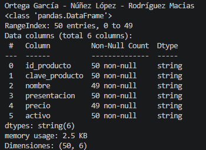

Figura 75. Reglas de calidad detectadas en producto.

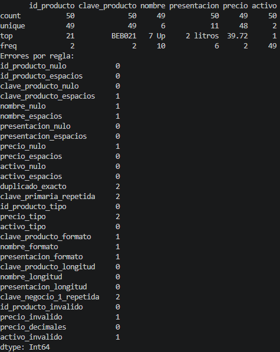

Figura 76. Resultado de limpieza y validación final de producto.

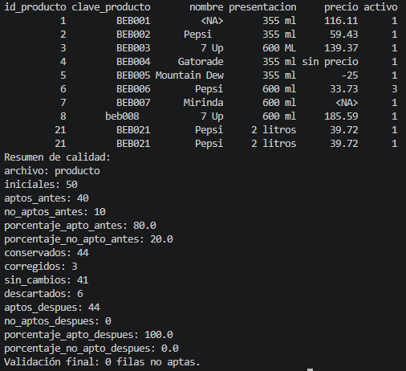

Figura 77. Inspección inicial del archivo lote.

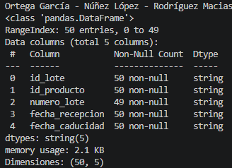

Figura 78. Reglas de calidad detectadas en lote.

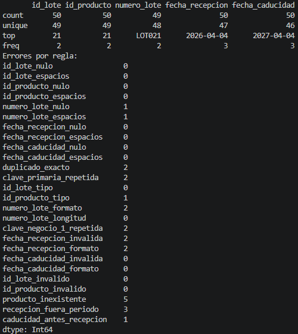

Figura 79. Resultado de limpieza y validación final de lote.

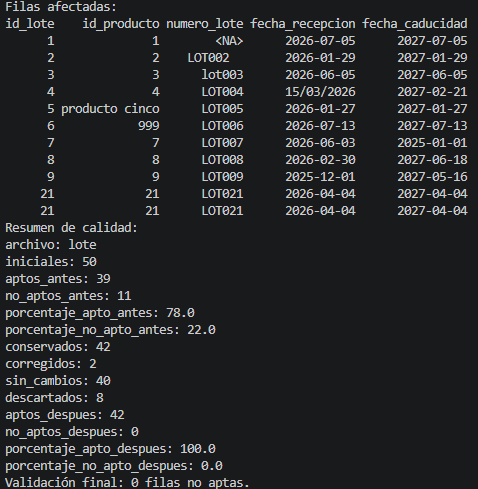

Figura 80. Inspección inicial del archivo inventario_lote.

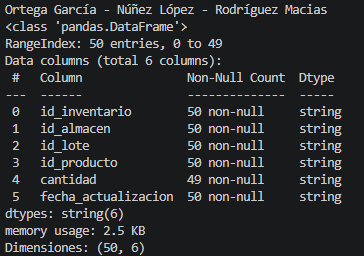

Figura 81. Reglas de calidad detectadas en inventario_lote.

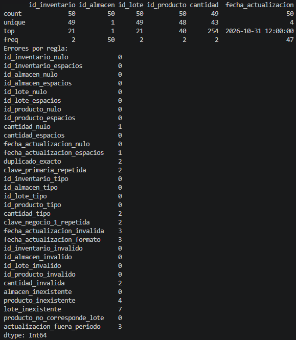

Figura 82. Resultado de limpieza y validación final de inventario_lote.

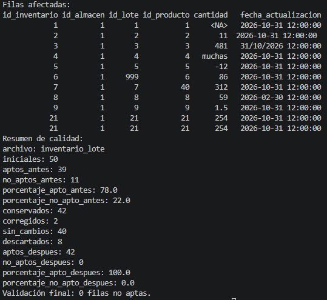


## EXPORTACIÓN Y REINTEGRACIÓN EN SQL SERVER

Se exportan archivos CSV con index=False para evitar que el índice interno de Pandas se convierta en una columna del almacén. Los acentos se conservan con UTF-8. Los archivos de origen permanecen separados de los resultados corregidos.

La reintegración se prepara en el esquema proyecto_u2 de pepsi_distribucion. Esto mantiene las tablas originales de dbo y evita reemplazar sus datos. Primero se debe ejecutar el código de creación; después, el script Python solicita usuario y contraseña de SQL Server. La contraseña no se escribe en los archivos. El controlador utilizado es ODBC Driver 18 for SQL Server, disponible en Linux.

El orden es almacen, producto, lote e inventario_lote para respetar las relaciones. La carga se realiza en una transacción: si falla una inserción, no se confirma el conjunto. El programa también verifica que el destino esté vacío para evitar cargar los mismos registros dos veces (SQLAlchemy, s. f.). Las capturas recibidas del equipo confirman la carga de un almacén, 44 productos, 42 lotes y 42 inventarios. Fueron tomadas en Windows con autenticación integrada; el script de este proyecto conserva la adaptación para Linux mediante usuario y contraseña de SQL Server.

```sql
-- Proyecto Unidad 2
-- ? Juan Manuel Ortega García
-- ! Bernardo Guillermo Núñez López
-- * Carlos Gabriel Rodríguez Macias

-- ? Estructura transcrita de las figuras 6 y 6.1 del documento del proyecto 1.
-- * No se utilizaron los scripts locales de Unidad1 como código base.
-- * Cambiamos únicamente el esquema de destino para conservar los datos de dbo.
-- * Ejecutar este archivo una sola vez, después de revisar la base seleccionada.
Use pepsi_distribucion;
GO

Create Schema proyecto_u2;
GO

-- ? Almacén de referencia. No es un cuarto CSV ni una cuarta tabla analizada.
Create Table proyecto_u2.almacen
(
  id_almacen int Primary Key Identity(1, 1),
  clave_almacen varchar(10) Not Null Unique,
  nombre varchar(100) Not Null,
  ubicacion varchar(200) Not Null,
  activo bit Not Null Default 1
);

Create Table proyecto_u2.producto
(
  id_producto int Primary Key Identity(1, 1),
  clave_producto varchar(15) Not Null Unique,
  nombre varchar(100) Not Null,
  presentacion varchar(50) Not Null,
  precio decimal(10, 2) Not Null,
  activo bit Not Null Default 1,
  Constraint ck_u2_producto_precio Check (precio > 0)
);

Create Table proyecto_u2.lote
(
  id_lote int Primary Key Identity(1, 1),
  id_producto int Not Null,
  numero_lote varchar(30) Not Null,
  fecha_recepcion date Not Null,
  fecha_caducidad date Not Null,
  Constraint fk_u2_lote_producto Foreign Key (id_producto)
    References proyecto_u2.producto(id_producto),
  Constraint uq_u2_lote_producto_numero Unique (id_producto, numero_lote),
  Constraint uq_u2_lote_validacion Unique (id_lote, id_producto),
  Constraint ck_u2_lote_fechas Check (fecha_caducidad > fecha_recepcion)
);

Create Table proyecto_u2.inventario_lote
(
  id_inventario int Primary Key Identity(1, 1),
  id_almacen int Not Null,
  id_lote int Not Null,
  id_producto int Not Null,
  cantidad int Not Null Default 0,
  fecha_actualizacion datetime2 Not Null Default Sysdatetime(),
  Constraint fk_u2_inventario_almacen Foreign Key (id_almacen)
    References proyecto_u2.almacen(id_almacen),
  Constraint fk_u2_inventario_lote_producto Foreign Key (id_lote, id_producto)
    References proyecto_u2.lote(id_lote, id_producto),
  Constraint uq_u2_inventario_almacen_lote Unique (id_almacen, id_lote),
  Constraint uq_u2_inventario_validacion
    Unique (id_inventario, id_lote, id_producto, id_almacen),
  Constraint ck_u2_inventario_cantidad Check (cantidad >= 0)
);
GO


```

```python
# Proyecto Unidad 2
# ? Juan Manuel Ortega García
# ! Bernardo Guillermo Núñez López
# * Carlos Gabriel Rodríguez Macias

# ? Usar SQLAlchemy y el controlador de SQL Server disponible en Linux.
from pathlib import Path
from getpass import getpass
from decimal import Decimal
import os
import pandas as pd
import pyodbc
from sqlalchemy import create_engine, URL, text
from sqlalchemy.exc import SQLAlchemyError

ruta = Path(__file__).resolve().parent.parent
print('Ortega García - Núñez López - Rodríguez Macias')
print('Controladores disponibles:', pyodbc.drivers())
servidor = os.getenv('SQLSERVER_HOST', 'localhost,1433')
base_datos = os.getenv('SQLSERVER_DATABASE', 'pepsi_distribucion')
usuario = input('Usuario de SQL Server: ')
contrasena = getpass('Contraseña de SQL Server: ')

# * En Linux no se supone una sesión integrada de Windows.
url = URL.create(
  'mssql+pyodbc', username=usuario, password=contrasena,
  host=servidor.split(',')[0], port=int(servidor.split(',')[1]) if ',' in servidor else 1433,
  database=base_datos,
  query={'driver': 'ODBC Driver 18 for SQL Server',
         'Encrypt': 'yes', 'TrustServerCertificate': 'yes'}
)
# * TrustServerCertificate se usa solo en esta instancia local académica.
motor = create_engine(url)

# ? Cargar las referencias antes de las tablas dependientes en una transacción.
try:
  with motor.begin() as conexion:
    for tabla in ['producto', 'lote', 'inventario_lote', 'almacen']:
      cantidad = conexion.execute(text(f'Select Count(*) From proyecto_u2.{tabla}')).scalar_one()
      if cantidad != 0:
        raise ValueError('El destino ya contiene datos. No se duplicará la carga.')
    conexion.execute(text('Set Identity_Insert proyecto_u2.almacen On'))
    conexion.execute(text(
      "Insert Into proyecto_u2.almacen "
      "(id_almacen, clave_almacen, nombre, ubicacion, activo) "
      "Values (1, 'ALM001', 'Almacén Nuevo Laredo', 'Nuevo Laredo, Tamaulipas', 1)"
    ))
    conexion.execute(text('Set Identity_Insert proyecto_u2.almacen Off'))
    for tabla in ['producto', 'lote', 'inventario_lote']:
      datos = pd.read_csv(ruta / 'csv_limpios' / f'{tabla}.csv')
      if datos.empty or datos.isnull().any().any():
        raise ValueError(f'El archivo {tabla} está vacío o contiene nulos.')
      if tabla == 'producto':
        datos['precio'] = datos['precio'].apply(lambda valor: Decimal(str(valor)))
      columnas = ', '.join(datos.columns)
      parametros = ', '.join(':' + columna for columna in datos.columns)
      instruccion = text(f'Insert Into proyecto_u2.{tabla} ({columnas}) Values ({parametros})')
      conexion.execute(text(f'Set Identity_Insert proyecto_u2.{tabla} On'))
      conexion.execute(instruccion, datos.to_dict(orient='records'))
      conexion.execute(text(f'Set Identity_Insert proyecto_u2.{tabla} Off'))
      print(tabla, ':', len(datos), 'filas insertadas dentro de la transacción.')
  print('Transacción confirmada: carga completa en SQL Server.')
except (SQLAlchemyError, ValueError, FileNotFoundError) as error:
  print('La carga no se confirmó:', error)
  raise SystemExit(1)
finally:
  motor.dispose()


```


## EVIDENCIAS DE CARGA Y CONSULTAS EN SQL SERVER

La salida de carga confirma la transacción y los conteos de filas exportadas. Las consultas mostradas después verifican que los registros limpios quedaron disponibles en las tablas producto, lote e inventario_lote del esquema proyecto_u2.

Figura 89. Carga confirmada de los datos limpios en SQL Server.

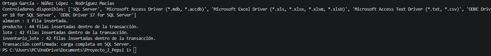

Figura 90. Consulta de registros cargados en producto.

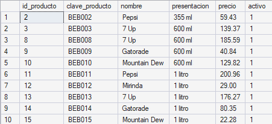

Figura 91. Consulta de registros cargados en lote.

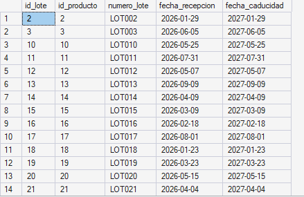

Figura 92. Consulta de registros cargados en inventario_lote.

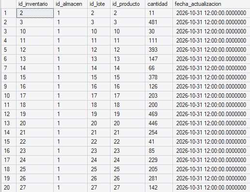


## CONSULTAS Y EFECTO DE LOS DATOS INCORRECTOS

La primera consulta suma unidades y calcula el valor del inventario por producto. Un precio negativo o una existencia duplicada habría alterado ese valor. La segunda identifica lotes próximos a caducar: una fecha mal interpretada cambia la prioridad de despacho. La tercera calcula promedio, mínimo y máximo de precios; un precio inválido puede distorsionar estos indicadores o impedir el cálculo.


## TABLA TEMPORAL Y VISTA ENCRIPTADA

La tabla temporal prepara un resumen para revisar existencias durante la misma conexión, sin modificar los registros del almacén. Puede utilizarse para organizar la revisión de cantidades y valores antes de un reporte. La vista reúne la consulta de existencias para reutilizarla.

WITH ENCRYPTION oculta la definición de la vista en las consultas habituales del catálogo; no cifra los datos que devuelve ni sustituye los permisos. Debe conservarse el código fuente para mantenimiento y se deben revisar sus limitaciones de publicación y replicación (Microsoft, s. f.-a).

```sql
-- Proyecto Unidad 2
-- ? Juan Manuel Ortega García
-- ! Bernardo Guillermo Núñez López
-- * Carlos Gabriel Rodríguez Macias
Use pepsi_distribucion;
GO

-- ? 1 Revisar el valor del inventario por producto.
Select p.id_producto, p.nombre, p.presentacion,
  Sum(i.cantidad) As unidades,
  Sum(i.cantidad * p.precio) As valor_inventario
From proyecto_u2.producto p
Inner Join proyecto_u2.inventario_lote i On p.id_producto = i.id_producto
Where p.activo = 1 And i.cantidad > 0
Group By p.id_producto, p.nombre, p.presentacion
Order By valor_inventario Desc;

-- ? 2 Revisar lotes con caducidad próxima desde el corte del ejercicio.
Select p.nombre, l.numero_lote, l.fecha_caducidad,
  Sum(i.cantidad) As unidades_por_caducar,
  Min(l.fecha_caducidad) As primera_caducidad
From proyecto_u2.lote l
Inner Join proyecto_u2.producto p On l.id_producto = p.id_producto
Inner Join proyecto_u2.inventario_lote i
  On l.id_lote = i.id_lote And l.id_producto = i.id_producto
Where l.fecha_caducidad >= '2026-11-02' And l.fecha_caducidad < '2027-03-01'
Group By p.nombre, l.numero_lote, l.fecha_caducidad
Order By l.fecha_caducidad Asc;

-- ? 3 Comparar precios de productos activos.
Select nombre, Count(*) As presentaciones,
  Avg(precio) As precio_promedio, Min(precio) As precio_minimo,
  Max(precio) As precio_maximo
From proyecto_u2.producto
Where activo = 1 And precio > 0
Group By nombre
Order By precio_promedio Desc;

-- ? Crear una tabla temporal para preparar la revisión del almacén.
-- * La tabla temporal solo se utiliza durante esta conexión.
Create Table #revision_inventario
(
  id_producto int,
  nombre varchar(100),
  unidades int,
  valor_inventario decimal(18, 2)
);

Insert Into #revision_inventario
Select p.id_producto, p.nombre, Sum(i.cantidad), Sum(i.cantidad * p.precio)
From proyecto_u2.producto p
Inner Join proyecto_u2.inventario_lote i On p.id_producto = i.id_producto
Group By p.id_producto, p.nombre;

Select * From #revision_inventario
Where unidades > 0
Order By valor_inventario Desc;
GO

-- ? Crear la vista encriptada para la consulta de existencias.
-- * With Encryption oculta la definición; no cifra las filas ni reemplaza permisos.
Create View proyecto_u2.vw_existencias_equipo
With Encryption
As
Select p.id_producto, p.nombre, p.presentacion, p.precio,
  Sum(i.cantidad) As existencia,
  Sum(i.cantidad * p.precio) As valor_inventario
From proyecto_u2.producto p
Inner Join proyecto_u2.inventario_lote i On p.id_producto = i.id_producto
Group By p.id_producto, p.nombre, p.presentacion, p.precio;
GO

Select * From proyecto_u2.vw_existencias_equipo
Order By valor_inventario Desc;

-- ? Comprobar que SQL Server no expone el texto de la vista.
Select Objectproperty(Object_Id('proyecto_u2.vw_existencias_equipo'), 'IsEncrypted')
  As vista_encriptada;
GO


```

El archivo contiene tres consultas con WHERE, ORDER BY y agregaciones, además de la tabla temporal y la vista. Las evidencias disponibles comprueban la carga y consultas directas de las tres tablas; aún se deben capturar los resultados de las tres consultas solicitadas, de la tabla temporal y de la vista encriptada.


## CONCLUSIÓN ACTUALIZADA

Con este proyecto relacionamos la administración de la base de datos con la calidad de la información que recibe. Python permitió generar registros, encontrar fallas y corregir únicamente lo que podía comprobarse. La validación evitó aceptar cantidades, precios o relaciones incorrectas que afectarían las decisiones del almacén.

El proceso ETL permitió conservar el origen, transformar los datos y preparar su reintegración. También comprendimos que un archivo con menos errores no basta: debemos revisar nuevamente sus reglas, justificar los descartes y comprobar sus relaciones. La carga en SQL Server y las consultas completan el proceso cuando se ejecutan y verifican con sus evidencias.


## REFERENCIAS DE LA UNIDAD II

Faker. (s. f.). Welcome to Faker’s documentation. https://faker.readthedocs.io/en/master/

Microsoft. (s. f.-a). CREATE VIEW (Transact-SQL). Microsoft Learn. https://learn.microsoft.com/en-us/sql/t-sql/statements/create-view-transact-sql

Microsoft. (s. f.-b). Extract, transform, load (ETL). Microsoft Learn. https://learn.microsoft.com/azure/architecture/data-guide/relational-data/etl

pandas. (s. f.-a). pandas.to_datetime. https://pandas.pydata.org/docs/reference/api/pandas.to_datetime.html

pandas. (s. f.-b). pandas.to_numeric. https://pandas.pydata.org/docs/reference/api/pandas.to_numeric.html

SQLAlchemy. (s. f.). Working with engines and connections. https://docs.sqlalchemy.org/en/20/core/connections.html


## ANEXO INTERNO PARA REVISIÓN DEL EQUIPO
